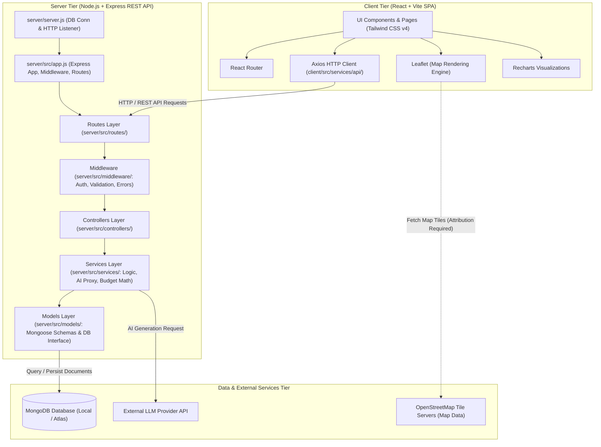
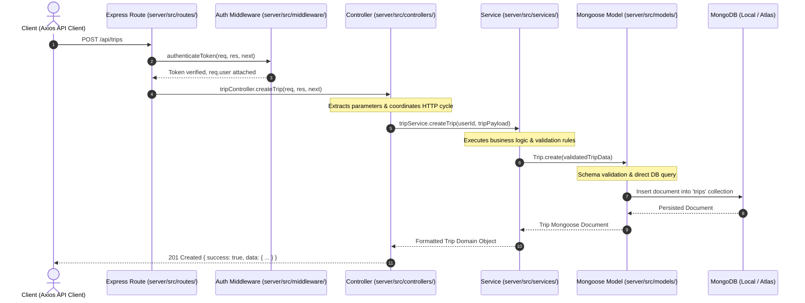
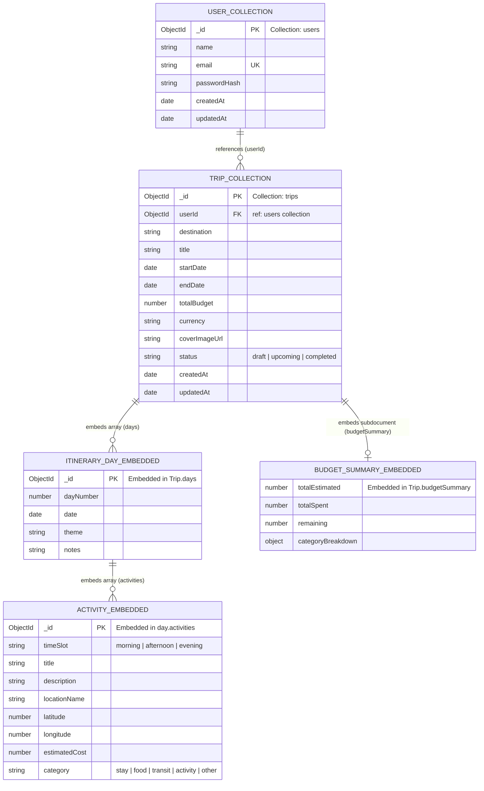

# TripMind — System Architecture & Technical Design

> **Document Status:** Active Baseline  
> **Applies to:** Frontend (`client/`), Backend (`server/`), and Database (`MongoDB Local / Atlas`).

---

## 1. System Overview

TripMind follows a decoupled client-server architecture. The frontend is a single-page application (SPA) built with React and Vite, styled using Tailwind CSS v4's CSS-first `@theme` configuration. The backend is a RESTful API built on Node.js and Express with its application entry point at `server/server.js` and modular application code under `server/src/`. Persistent data is stored in MongoDB (local instance for development or MongoDB Atlas in cloud deployment) via Mongoose ODM. External integrations (such as LLM APIs) are strictly mediated through backend services to protect credentials and enforce business logic.



---

## 2. Backend Architecture (Node.js & Express)

The backend adheres to a strict separation of concerns, decoupling root server startup (`server/server.js`) from Express application pipeline configuration (`server/src/app.js`) and internal layers under `server/src/`.



### 2.1 Server Structure & Layer Responsibilities

#### 1. Server Entry Point (`server/server.js`)
- **Primary Role:** Lifecycle and infrastructure management.
- Loads environment variables from `.env` via `dotenv`.
- Establishes connection to MongoDB (local instance or MongoDB Atlas) through Mongoose.
- Instantiates the HTTP server wrapping the configured Express `app` and listens on `PORT`.
- Manages process event listeners (`SIGINT`, `SIGTERM`, `unhandledRejection`) for graceful shutdown and resource cleanup.
- **Strict Boundary:** Does not declare routes, mount application middleware, or contain business logic.

#### 2. Express Application Configuration (`server/src/app.js`)
- **Primary Role:** Express application factory and pipeline configuration.
- Instantiates Express `app`.
- Mounts top-level middleware: CORS (`cors`), security headers (`helmet`), JSON body parser (`express.json`), and HTTP request logging.
- Mounts API route routers under the `/api` prefix (e.g., `/api/auth`, `/api/trips`, `/api/ai`).
- Mounts 404 handler for unrecognized endpoints and the centralized error handling middleware.
- Exports the configured `app` for use by `server/server.js` and automated integration tests.
- **Strict Boundary:** Does not listen on a port and does not connect directly to the database.

#### 3. Routes (`server/src/routes/`)
- Define URL paths and map HTTP verbs (`GET`, `POST`, `PUT`, `PATCH`, `DELETE`).
- Mount route-level middleware chains (authentication guards, validation schemas).
- Dispatch incoming requests directly to the corresponding controller method.
- **Strict Boundary:** Zero business logic, data transformation, or database operations.

#### 4. Middleware (`server/src/middleware/`)
- **Authentication Guard (`auth.js`):** Extracts and validates JWT tokens (from headers or cookies depending on the finalized token strategy), decodes user identity, and attaches `req.user`.
- **Request Validation:** Validates schema conformity for `req.body`, `req.params`, and `req.query` before controller execution.
- **Centralized Error Handling (`errorHandler.js`):** Catches all exceptions forwarded via `next(err)` and returns standardized JSON error responses with status codes.
- **Security & Headers:** Configures CORS, Helmet security headers, and request rate limiting.

#### 5. Controllers (`server/src/controllers/`)
- **Primary Role:** Coordinate the HTTP request and response lifecycle.
- Extract request parameters from `req.params`, `req.query`, `req.body`, and user context from `req.user`.
- Invoke domain services with sanitized inputs.
- Set appropriate HTTP status codes (`200 OK`, `201 Created`, `400 Bad Request`, `401 Unauthorized`, `403 Forbidden`, `404 Not Found`).
- Construct and return the standardized JSON response envelope.
- Forward caught errors to the error-handling middleware via `next(error)`.
- **Strict Boundary:** Controllers do not contain business logic and never perform direct Mongoose/MongoDB queries.

#### 6. Services (`server/src/services/`)
- **Primary Role:** Contain and execute all domain and business logic.
- Execute database operations exclusively through Mongoose models.
- **AI Integration (`aiService.js`):** Construct system prompts, structure context, call the external LLM API, and parse/validate returned JSON itineraries.
- **Budget Computation (`budgetService.js`):** Perform calculations, expense categorizations, and balance tracking across itinerary days.
- **Strict Boundary:** Services are completely decoupled from Express `req` and `res` objects to ensure pure testability.

#### 7. Models (`server/src/models/`)
- **Primary Role:** Define schemas and interact directly with MongoDB.
- Specify Mongoose schemas with field types, required constraints, validators, and default values.
- Declare collection indexes for query performance (e.g., `{ userId: 1, createdAt: -1 }`).
- Define schema lifecycle hooks (specifically **single-point password hashing** via `pre('save')` on the `User` schema) and instance methods (e.g., `user.comparePassword()`).
- Manage direct database persistence, mutations, and query execution for MongoDB (local or Atlas).

#### 8. Configuration Layer (`server/src/config/`)
- **Environment Management (`env.js`):** Centralizes and validates environment configuration on process startup. Loads `server/.env` via `dotenv` and halts startup if critical variables (`MONGODB_URI`) are missing, unconfigured, or contain placeholder credentials. Supports local MongoDB URIs for development and requires explicit production database configuration without silent localhost fallbacks.
- **Database Connection (`db.js`):** Encapsulates the Mongoose connection lifecycle (`connectDB`, `disconnectDB`, `getDbStatus`), ensuring connections are established prior to HTTP server binding, logging sanitized host metadata without credential leakage, and safely reporting connection states.

### 2.2 Server Directory Layout
```
server/
├── src/
│   ├── config/
│   │   ├── env.js         # Validated environment configuration
│   │   └── db.js          # Mongoose connection & lifecycle
│   ├── controllers/       # HTTP request coordinators
│   ├── models/            # Mongoose schemas & data models
│   ├── routes/            # Route declarations & endpoint binding
│   │   └── health.routes.js # GET /api/health endpoint
│   ├── middleware/        # Auth guards, validation, error handlers
│   ├── services/          # Domain services & business logic
│   ├── validators/        # Input validation schemas
│   ├── utils/             # Shared server utilities
│   └── app.js             # Express application configuration & middleware
├── server.js              # Server entry point & process lifecycle
├── .env                   # Local secrets (excluded from Git)
├── .env.example           # Sanitized environment template
└── .gitignore             # Server Git exclusion rules
```

---

## 3. Database Architecture (MongoDB & Mongoose)

### 3.1 Collections vs. Embedded Subdocuments

TripMind distinguishes between **independent top-level collections** and **embedded subdocuments** to balance query speed, atomic consistency, and schema simplicity:

- **Independent MongoDB Collections:**
  - `users`: Stores user accounts, hashed credentials, and profile timestamps.
  - `trips`: Stores trip metadata, settings, and references the owning user via `userId` (`type: mongoose.Schema.Types.ObjectId, ref: 'User'`).
- **Embedded Subdocuments (inside `trips` collection for MVP):**
  - `ItineraryDay`: Embedded array within the `Trip` document representing sequential travel days.
  - `Activity`: Embedded array within each `ItineraryDay` representing scheduled events, stops, and activities.
  - `BudgetSummary`: Embedded subdocument within the `Trip` document aggregating estimated costs, actual spend, and categorical breakdowns.

### 3.2 Document Schema & Entity Relationship Diagram



### 3.3 Deletion Mechanics & Embedded Lifecycle
1. **Atomic Document Deletion:** Because `days`, `activities`, and `budgetSummary` reside physically inside the `Trip` document as embedded subdocuments, deleting a `Trip` document removes all associated itinerary and budget data in a single, atomic MongoDB operation.
2. **No Multi-Collection Cascades:** Unlike relational databases that require cascade triggers or foreign key cascades across multiple tables, TripMind's document model eliminates cascading operations and guarantees zero orphaned records upon trip deletion.
3. **Data Volume Fit:** A typical itinerary spans 1 to 21 days with 3 to 6 activities per day, easily remaining well under MongoDB's 16MB document size limit.

---

## 4. Frontend Architecture (React + Vite + Tailwind CSS v4)

### 4.1 Component Structure & Modularity
```
client/src/
├── assets/             # Brand assets, icons, typography files
├── components/
│   ├── common/         # Generic UI primitives: Button, Input, Modal, Card, Badge
│   ├── layout/         # Shell, Navbar, Footer, Sidebar, PageContainer
│   ├── itinerary/      # DaySelector, ActivityTimeline, ActivityCard, AddActivityModal
│   ├── budget/         # BudgetBarChart, ExpenseBreakdownTable, MetricCard
│   ├── map/            # LeafletMapContainer, ActivityMarker, BoundsController
│   └── discovery/      # DestinationCard, DestinationGrid, FilterPills
├── context/            # AuthContext, TripContext (cross-cutting application state)
├── hooks/              # Custom hooks: useAuth, useTrip, useLeafletMap
├── pages/              # Route views: LandingPage, LoginPage, RegisterPage, Dashboard, TripDetailPage
├── services/
│   └── api/            # Standardized Axios API clients:
│       ├── apiClient.js    # Base Axios instance, interceptors, error mapping
│       ├── authApi.js      # Authentication endpoints (login, register, logout)
│       ├── tripApi.js      # Trip CRUD endpoints
│       └── aiApi.js        # AI itinerary generation endpoint
├── index.css           # Tailwind CSS v4 @import "tailwindcss" and @theme declarations
└── utils/              # Formatting helpers, date math, currency tools, validators
```

### 4.2 API Client Layer (`client/src/services/api/`)
All backend network calls must be routed through dedicated API modules in `client/src/services/api/`:
- **`apiClient.js`:** Exports the configured Axios instance with base URL, timeout configurations, and request/response interceptors.
- **Credential Handling:** The request interceptor handles authentication credentials based on the finalized token strategy (attaching Authorization header or configuring cookie credentials).
- Components and pages must never call raw `fetch` or instantiate isolated `axios` instances.

---

## 5. Security & Authentication Architecture

### 5.1 Authentication Strategy & Token Storage Evaluation
TripMind utilizes JWT for stateless authentication and `bcrypt` for salted password hashing. The exact client-side token storage mechanism is explicitly marked as **PENDING** in [`DECISIONS.md`](./DECISIONS.md) (`Pending-002`).

#### Security Trade-Off Analysis:

| Storage Strategy | Resistance to XSS | Resistance to CSRF | Implementation Requirements & Trade-offs |
| :--- | :--- | :--- | :--- |
| **HttpOnly, Secure Cookies** | **High:** Inaccessible to client JavaScript; tokens cannot be stolen via Cross-Site Scripting (XSS). | **Vulnerable if unmitigated:** Browser automatically includes cookies in cross-origin requests. | Requires `SameSite=Lax` or `Strict`, anti-CSRF tokens for mutating actions, and `credentials: true` in CORS settings. |
| **Client-Held Bearer Token (`localStorage`)** | **Vulnerable:** Any script execution (malicious dependency, XSS vulnerability) can access and exfiltrate the token. | **High:** Browsers do not automatically attach tokens to requests; requires explicit header injection. | Simpler setup across domains, but creates a high-severity risk if an XSS vulnerability exists. |
| **In-Memory Storage + Silent Refresh** | **High:** Inaccessible via `localStorage` dumps; lost on page reload. | **High:** Bearer headers must be attached explicitly. | Requires a secondary refresh token mechanism (often via HttpOnly cookie) to survive page reloads. |

> **Directive:** The final decision between HttpOnly cookies and client Bearer tokens must be finalized in [`DECISIONS.md`](./DECISIONS.md) after evaluating XSS and CSRF implications prior to authentication implementation. Neither option is assumed finalized in current code or specs.

### 5.2 Single-Point Password Hashing Rule
- Password hashing is encapsulated exclusively in the Mongoose `User` schema `pre('save')` hook (`server/src/models/User.js`).
- The hook checks `if (!this.isModified('password')) return next();` and hashes the plain password using `bcrypt` (10 salt rounds).
- Domain services (`server/src/services/authService.js`) pass the raw, validated password directly to `User.create()`. Services are strictly prohibited from pre-hashing passwords, eliminating the risk of double-hashing.
- Password verification during login uses the schema method `user.comparePassword(candidatePassword)` which delegates to `bcrypt.compare`.

### 5.3 Stateless Logout vs. Server-Side Revocation
- **Stateless Logout (MVP):** For the MVP, logging out is achieved on the client side by clearing the stored authentication credential or clearing the authentication cookie via `res.clearCookie()`.
- **Server-Side Revocation (Deferred):** Active server-side token revocation (such as Redis-backed token blacklists or short-lived token rotation) is explicitly deferred beyond the MVP.

### 5.4 AI & External Service Isolation
- LLM API keys reside strictly on the server (`server/.env`).
- Client requests for AI itinerary generation are routed to `POST /api/ai/generate-itinerary`. The Express backend validates inputs, applies rate limits, constructs the prompt, invokes the LLM API, and validates the structured output.

---

## 6. Mapping Architecture & OpenStreetMap Policies

### 6.1 Roles of Leaflet and OpenStreetMap
- **Leaflet:** The client-side JavaScript map rendering library responsible for rendering interactive map controls, pan/zoom viewports, markers, and popup overlays.
- **OpenStreetMap (OSM):** The collaborative project providing the underlying geographic map data and raster tile imagery.

### 6.2 Tile Usage Policy & Attribution Requirements
Public standard tile servers (`tile.openstreetmap.org`) are operated entirely on donated resources by the OpenStreetMap Foundation. They **do not guarantee high availability or unlimited free usage for production applications**.

The TripMind mapping integration must adhere strictly to the following requirements:
1. **Mandatory Attribution:** Every map instance must prominently display the required attribution notice: `© OpenStreetMap contributors`.
2. **Browser Environment & Tile Requests:**
   - Web browsers strictly prohibit client-side JavaScript from modifying the `User-Agent` HTTP header for tile image requests (Fetch/XHR/``). Browser tile requests rely on standard browser header propagation (`Referer` and `Origin`).
   - Standard OSM tile servers are suitable for development, prototyping, and low-traffic MVP testing only.
   - Bulk downloading, heavy automated requests, or aggressive pre-fetching of tiles is strictly prohibited.
3. **Tile Caching:** Tile requests must be cached locally by the browser in accordance with HTTP cache control headers.
4. **Production Path:** If application usage grows beyond low-volume MVP limits, TripMind must transition to a dedicated tile provider (e.g., Stadia Maps, MapTiler, Protomaps) or deploy a self-hosted tile cache.

### 6.3 Separation of Geocoding
- **Geocoding** (converting text addresses or landmark names into latitude/longitude coordinates) is an independent technical problem from map rendering and tile serving.
- Geocoding technical options are evaluated separately in [`DECISIONS.md`](./DECISIONS.md) (`Pending-003`).

---

## 7. Standardized API Response Envelope

Every Express API endpoint must return JSON adhering to the following structure:

### 7.1 Success Format
```json
{
  "success": true,
  "data": { ... },
  "message": "Operation completed successfully"
}
```

### 7.2 Error Format
```json
{
  "success": false,
  "error": {
    "code": "RESOURCE_NOT_FOUND",
    "message": "The requested trip was not found.",
    "details": []
  }
}
```

> **Consistency Rule:** The `details` field must always be an array. When specific validation errors are present, it contains an array of detail objects; when no additional detail is available, it must be standardized as an empty array `[]` (never `null` or undefined).
