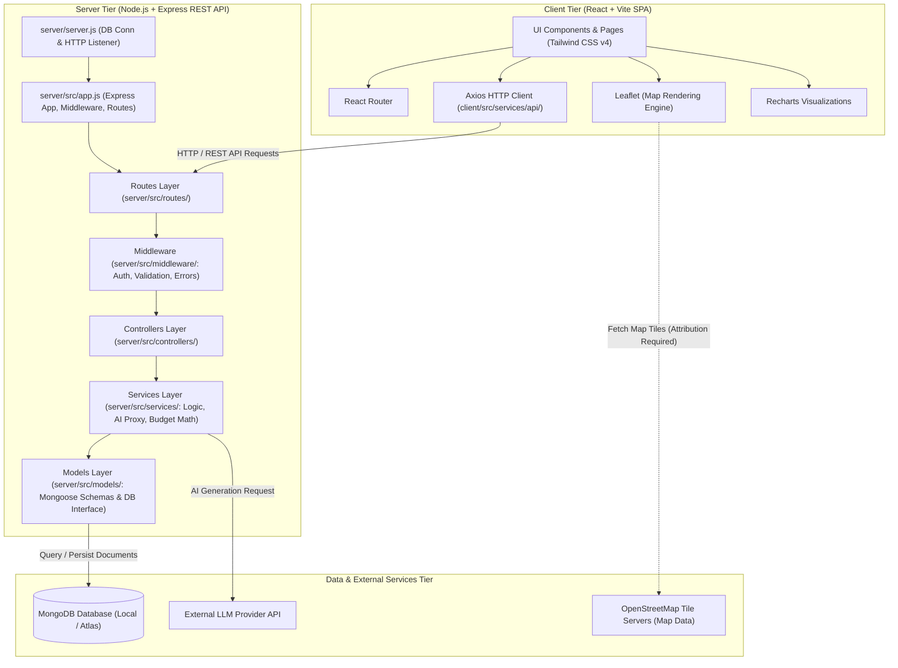
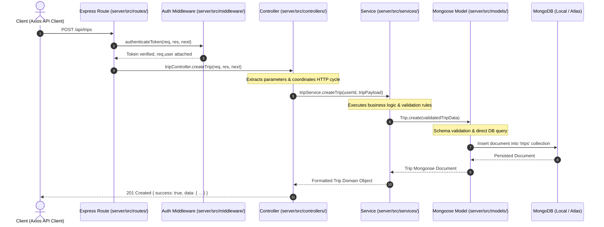
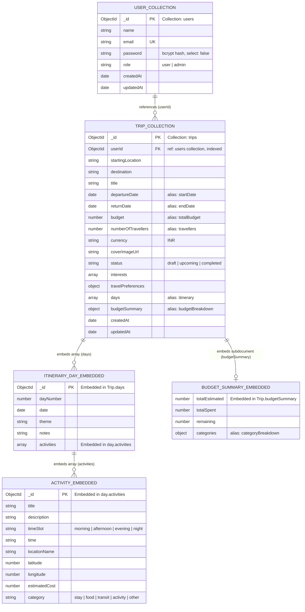

# TripMind — System Architecture & Technical Design

> **Document Status:** Active Baseline  
> **Applies to:** Frontend (`client/`), Backend (`server/`), and Database (`MongoDB Local / Atlas`).

---

## 1. System Overview

TripMind follows a decoupled client-server architecture. The frontend is a single-page application (SPA) built with React and Vite, styled using Tailwind CSS v4's CSS-first `@theme` configuration. The backend is a RESTful API built on Node.js and Express with its application entry point at `server/server.js` and modular application code under `server/src/`. Persistent data is stored in MongoDB (local instance for development or MongoDB Atlas in cloud deployment) via Mongoose ODM. External integrations (such as LLM APIs) are strictly mediated through backend services to protect credentials and enforce business logic.



---

## 2. Backend Architecture (Node.js & Express)

The backend adheres to a strict separation of concerns, decoupling root server startup (`server/server.js`) from Express application pipeline configuration (`server/src/app.js`) and internal layers under `server/src/`.



### 2.1 Server Structure & Layer Responsibilities

#### 1. Server Entry Point (`server/server.js`)
- **Primary Role:** Lifecycle and infrastructure management.
- Loads environment variables from `.env` via `dotenv`.
- Establishes connection to MongoDB (local instance or MongoDB Atlas) through Mongoose.
- Instantiates the HTTP server wrapping the configured Express `app` and listens on `PORT`.
- Manages process event listeners (`SIGINT`, `SIGTERM`, `unhandledRejection`) for graceful shutdown and resource cleanup.
- **Strict Boundary:** Does not declare routes, mount application middleware, or contain business logic.

#### 2. Express Application Configuration (`server/src/app.js`)
- **Primary Role:** Express application factory and pipeline configuration.
- Instantiates Express `app`.
- Enforces strict 9-stage middleware ordering:
  1. **Proxy Trust:** `app.set('trust proxy', config.trustProxy || 1)` (trusts first hop for Render reverse proxy alignment).
  2. **Security Headers (Helmet):** `app.disable('x-powered-by')` and `app.use(helmet({ ... }))` removing runtime fingerprinting, enforcing `Cross-Origin-Resource-Policy: cross-origin`, COOP, COEP, strict Referrer Policy, and CSP.
  3. **CORS:** Strict origin mapping (`config.clientUrl`), `credentials: true`, whitelisted methods and headers.
  4. **Parsers:** `express.json({ limit: '1mb' })` (with payload size cap to prevent body-parsing DoS) and `cookieParser()`.
  5. **Infrastructure Health Check:** `app.use('/api', healthRoutes)` mounted before rate limiters to ensure uptime monitoring is never blocked.
  6. **General API Rate Limiting:** `app.use('/api', apiRateLimiter)` providing 120 req/15min baseline protection.
  7. **Domain & Route-Specific Limiters:**
     - `authRateLimiter`: 10 attempts/15min on `/api/auth/login` and `/api/auth/register`.
     - `aiRateLimiter`: 15 req/min on `/api/trips/:id/generate-itinerary` and `/api/trips/:tripId/assistant/messages`.
     - `publicShareRateLimiter`: 60 req/min on `/api/trips/shared/:token`.
  8. **Authentication & Domain Routers:** Mounted under `/api/auth`, `/api/trips`, and `/api/destinations`.
  9. **404 & Centralized Error Handling:** Uniform error envelope with status normalization and `details: []`.
- Exports the configured `app` for use by `server/server.js` and automated integration tests.
- **Strict Boundary:** Does not listen on a port and does not connect directly to the database.

#### 3. Routes (`server/src/routes/`)
- Define URL paths and map HTTP verbs (`GET`, `POST`, `PUT`, `PATCH`, `DELETE`).
- Mount route-level middleware chains (authentication guards, validation schemas).
- Dispatch incoming requests directly to the corresponding controller method.
- **Strict Boundary:** Zero business logic, data transformation, or database operations.

#### 4. Middleware (`server/src/middleware/`)
- **Authentication Guard (`authMiddleware.js`):** Extracts and validates JWT tokens from the HttpOnly `token` cookie (via `cookie-parser`), enforces `HS256` signature verification and expiration, decodes user identity, and attaches `req.user = { id: decoded.sub }`.
- **Request Validation (`validators/`):** Validates schema conformity for `req.body`, `req.params`, and `req.query` before controller execution.
- **Centralized Error Handling:** Catches all exceptions forwarded via `next(err)` and returns standardized JSON error responses with status codes.
- **Security & Parsers:** Configures CORS, JSON body parser (`express.json`), and cookie parsing (`cookie-parser`).

#### 5. Controllers (`server/src/controllers/`)
- **Primary Role:** Coordinate the HTTP request and response lifecycle.
- Extract request parameters from `req.params`, `req.query`, `req.body`, and user context from `req.user`.
- Invoke domain services with sanitized inputs.
- Set appropriate HTTP status codes (`200 OK`, `201 Created`, `400 Bad Request`, `401 Unauthorized`, `403 Forbidden`, `404 Not Found`).
- Construct and return the standardized JSON response envelope.
- Forward caught errors to the error-handling middleware via `next(error)`.
- **Strict Boundary:** Controllers do not contain business logic and never perform direct Mongoose/MongoDB queries.

#### 6. Services (`server/src/services/`)
- **Primary Role:** Contain and execute all domain and business logic.
- Execute database operations exclusively through Mongoose models.
- **AI Integration (`aiService.js`):** Encapsulates external Google Gemini API communication via `@google/genai`. Formats and sanitizes provider error responses, executes backend connectivity smoke testing (`verifyGeminiConnection()`), and isolates LLM provider details from controllers and client code. Full prompt generation and JSON schema output validation are scheduled for subsequent itinerary generation milestones.
- **Budget Computation (`budgetService.js`):** Perform calculations, expense categorizations, and balance tracking across itinerary days.
- **Strict Boundary:** Services are completely decoupled from Express `req` and `res` objects to ensure pure testability.

#### 7. Models (`server/src/models/`)
- **Primary Role:** Define schemas and interact directly with MongoDB.
- Specify Mongoose schemas with field types, required constraints, validators, and default values.
- Declare collection indexes for query performance (e.g., `{ userId: 1, createdAt: -1 }`).
- Define schema lifecycle hooks (specifically **single-point password hashing** via `pre('save')` on the `User` schema) and instance methods (e.g., `user.comparePassword()`).
- Manage direct database persistence, mutations, and query execution for MongoDB (local or Atlas).

#### 8. Configuration Layer (`server/src/config/`)
- **Environment Management (`env.js`):** Centralizes and validates environment configuration on process startup. Loads `server/.env` via `dotenv` and halts startup if critical variables (`MONGODB_URI`, `JWT_SECRET`) are missing, unconfigured, or contain placeholder credentials. Validates `GEMINI_API_KEY` placeholder guards and exposes configuration options for Gemini (`geminiApiKey`, `geminiModel`).
- **Database Connection (`db.js`):** Encapsulates the Mongoose connection lifecycle (`connectDB`, `disconnectDB`, `getDbStatus`), ensuring connections are established prior to HTTP server binding, logging sanitized host metadata without credential leakage, and safely reporting connection states.
- **AI Client Configuration (`gemini.js`):** Configures and exports a cached singleton instance of the official Google GenAI JavaScript client (`GoogleGenAI` from `@google/genai`) and resolves the model identifier from `GEMINI_MODEL` (defaulting to `gemini-3.5-flash-lite`). Avoids creating separate client instances per request and isolates provider initialization.

### 2.2 Server Directory Layout
```
server/
├── src/
│   ├── config/
│   │   ├── env.js         # Validated environment configuration (MongoDB, JWT, Gemini)
│   │   ├── db.js          # Mongoose connection & lifecycle
│   │   └── gemini.js      # Reusable GoogleGenAI singleton & model configuration
│   ├── controllers/       # HTTP request coordinators
│   │   ├── authController.js # Registration, login, logout & profile handlers
│   │   ├── destinationController.js # Public destination retrieval handlers
│   │   └── tripController.js # Trip creation & management handlers
│   ├── data/              # Centralized static & seed datasets
│   │   └── destinations.js # Curated destination dataset & WGS84 coordinates
│   ├── models/            # Mongoose schemas & data models
│   │   ├── Trip.js        # Trip model with embedded itinerary & budget breakdown
│   │   └── User.js        # User model with single-point bcrypt hashing
│   ├── routes/            # Route declarations & endpoint binding
│   │   ├── auth.routes.js # POST /register, POST /login, POST /logout, GET /me
│   │   ├── destination.routes.js # GET /api/destinations, GET /api/destinations/:identifier
│   │   ├── health.routes.js # GET /api/health endpoint
│   │   └── trip.routes.js # GET/POST /api/trips, GET/PATCH/DELETE /api/trips/:id, GET /api/trips/shared/:token, GET/POST /api/trips/:id/share
│   ├── middleware/        # Auth guards, validation, error handlers
│   │   └── authMiddleware.js # HttpOnly cookie JWT verification & req.user guard
│   ├── schemas/           # Structured response & JSON schema contracts
│   │   └── itinerarySchema.js # Gemini & standard JSON schemas for AI itinerary generation
│   ├── scripts/           # Standalone diagnostic & administrative scripts
│   │   └── verifyGemini.js # Diagnostic CLI smoke test for Gemini API connectivity
│   ├── services/          # Domain services & business logic
│   │   ├── aiService.js   # Gemini API mediation, error normalization & connectivity test
│   │   ├── authService.js # Registration, login & profile domain logic
│   │   ├── budgetService.js # Authoritative budget math & reconciliation
│   │   ├── destinationService.js # Destination retrieval, filtering & validation
│   │   └── tripService.js # Trip creation, retrieval, update, delete & domain operations
│   ├── validators/        # Input validation schemas
│   │   ├── authValidator.js # Registration & login payload validation
│   │   └── tripValidator.js # Trip creation, query, param & update validation
│   ├── utils/             # Shared server utilities
│   │   └── token.js       # JWT generation, verification & expiration constants
│   └── app.js             # Express application configuration & middleware
├── server.js              # Server entry point & process lifecycle
├── .env                   # Local secrets (excluded from Git)
├── .env.example           # Sanitized environment template
└── .gitignore             # Server Git exclusion rules
```

---

## 3. Database Architecture (MongoDB & Mongoose)

### 3.1 Collections vs. Embedded Subdocuments

TripMind distinguishes between **independent top-level collections** and **embedded subdocuments** to balance query speed, atomic consistency, and schema simplicity:

- **Independent MongoDB Collections:**
  - `users`: Stores user accounts, hashed credentials, and profile timestamps.
  - `trips`: Stores trip metadata, settings, and references the owning user via `userId` (`type: mongoose.Schema.Types.ObjectId, ref: 'User'`).
- **Embedded Subdocuments (inside `trips` collection for MVP):**
  - `ItineraryDay`: Embedded array within the `Trip` document representing sequential travel days.
  - `Activity`: Embedded array within each `ItineraryDay` representing scheduled events, stops, and activities.
  - `BudgetSummary`: Embedded subdocument within the `Trip` document aggregating estimated costs, actual spend, and categorical breakdowns.

### 3.2 Document Schema & Entity Relationship Diagram



### 3.3 Deletion Mechanics & Embedded Lifecycle
1. **Atomic Document Deletion:** Because `days`, `activities`, and `budgetSummary` reside physically inside the `Trip` document as embedded subdocuments, deleting a `Trip` document removes all associated itinerary and budget data in a single, atomic MongoDB operation.
2. **No Multi-Collection Cascades:** Unlike relational databases that require cascade triggers or foreign key cascades across multiple tables, TripMind's document model eliminates cascading operations and guarantees zero orphaned records upon trip deletion.
3. **Data Volume Fit:** A typical itinerary spans 1 to 30 days with 3 to 6 activities per day, easily remaining well under MongoDB's 16MB document size limit.

### 3.4 Concurrency-Safe Partial Updates & Nested Subdocument Preservation
1. **Conditional Atomic Query Invariants:** To guard against Time-of-Check to Time-of-Use (TOCTOU) race conditions during partial date updates, single-date updates embed counterpart date conditions directly into the atomic `findOneAndUpdate` query filter:
   - Updating `departureDate` only: requires `returnDate: { $gt: newDepartureDate }`.
   - Updating `returnDate` only: requires `departureDate: { $lt: newReturnDate }`.
   Under concurrent opposing requests, MongoDB document-level write locks serialize operations so at most one succeeds, guaranteeing that inverted date ranges can never be persisted.
2. **Dot-Notation Path Updates for Embedded Subdocuments:** Partial updates to `travelPreferences` are flattened into dot-notation paths (`'travelPreferences.pace'`, etc.) before applying `$set`. This preserves unmentioned sibling subdocument fields (`accommodationType`, `transportation`, `dietary`, `notes`) without full-object replacement.
3. **Array Ceilings:** To prevent unbounded document growth, `interests` is capped at 30 items and `travelPreferences.dietary` is capped at 20 items at both the request validator and Mongoose schema levels.

### 3.5 Itinerary Activity Modification Architecture (Day 32)
1. **Endpoint Specification:** `PATCH /api/trips/:tripId/days/:dayId/activities/:activityId`
2. **Identification Strategy:**
   - Both `itineraryDaySchema` and `activitySchema` are embedded subdocuments with `{ _id: true }` enabled in `server/src/models/Trip.js`.
   - Mongoose automatically assigns stable, globally unique 24-character hexadecimal `_id` ObjectIds upon itinerary creation.
   - Subdocuments are addressed directly using Mongoose subdocument methods: `trip.days.id(dayId)` and `day.activities.id(activityId)`.
3. **Anti-Enumeration Ownership Model:**
   - Authorization is enforced at the database query level: `Trip.findOne({ _id: tripId, userId: user._id })`.
   - If an unauthorized user attempts to query or modify an activity belonging to another traveler's trip, the query yields `null`, returning HTTP 404 `NOT_FOUND` (identical to non-existent trips), entirely eliminating ID enumeration or scanning attack vectors.
4. **Partial Subdocument Update Behavior:**
   - Request payloads are validated by `validateUpdateActivity` in `server/src/validators/activityValidator.js`.
   - Protected fields (`_id`, `userId`, `tripId`, `dayId`, `activityId`, `createdAt`, `updatedAt`, `__v`) and arbitrary unrecognized keys are rejected with HTTP 400 `VALIDATION_ERROR`.
   - Permitted fields (`title`, `name`, `description`, `timeSlot`, `time`, `duration`, `locationName`, `category`, `estimatedCost`, `costBreakdown`, `latitude`, `longitude`) are partially applied to the target activity subdocument.
   - Unsupplied fields are strictly preserved in their existing state.
   - The embedded `activity.location` subdocument (`name`, `latitude`, `longitude`) is synchronized automatically with `locationName` and provided coordinates.
5. **Dynamic Budget Summary Recalculation:**
   - If `estimatedCost` or `category` is modified, `updateTripActivity` in `server/src/services/tripService.js` delegates to `recalculateTripBudgetSummary(trip)` across all days within the trip to recalculate:
     - `trip.budgetSummary.totalEstimated`: sum of all activities' `estimatedCost`.
     - `trip.budgetSummary.remaining`: `Math.max(0, trip.budget - totalEstimated)`.
     - `trip.budgetSummary.categories`: re-tallied per category (`accommodation`, `food`, `transportation`, `activities`, `localTransport`, `miscellaneous`).
   - The updated document is persisted via `await trip.save()` and returned in the standardized response envelope `{ success: true, data: { activity, trip }, message }`.

### 3.6 Itinerary Activity Creation & Deletion Architecture (Day 33)
1. **Endpoint Specifications:**
   - Add Activity: `POST /api/trips/:tripId/days/:dayId/activities`
   - Remove Activity: `DELETE /api/trips/:tripId/days/:dayId/activities/:activityId`
2. **Identification & Subdocument Addressing:**
   - Parameter validation enforces 24-character hexadecimal ObjectIds (`validateDayParams` and `validateActivityParams`).
   - Target day is located using Mongoose subdocument helper: `const day = trip.days.id(dayId)`.
   - For deletion, target activity is located using `const activity = day.activities.id(activityId)`.
3. **Subdocument Array Mutation Mechanics:**
   - **Adding an Activity:** `day.activities.push(activityData)` creates a new embedded subdocument with a unique Mongoose-generated `_id` ObjectId. Sibling activities within the day and all other days remain untouched.
   - **Removing an Activity:** `day.activities.pull({ _id: activity._id })` performs an atomic in-memory subdocument removal targeting the unique ObjectId. Sibling activities in the array are preserved without re-indexing artifacts.
4. **Validation & Protection:**
   - Add activity payload is sanitized via `validateAddActivity`.
   - Title is strictly required and non-empty.
   - Client-supplied protected keys (`_id`, `userId`, `tripId`, `dayId`, etc.) and unrecognized fields are rejected with HTTP 400.
   - Validates category (`stay`, `food`, `transit`, `activity`, `other`) and timeSlot (`morning`, `afternoon`, `evening`, `night`) enums.
   - Enforces non-negative `estimatedCost` and coordinate mutual nullability.
5. **Centralized Financial Recalculation:**
   - All mutations delegate to `recalculateTripBudgetSummary(trip)` before `await trip.save()`.
   - Handles edge cases:
     - Zero activities: `totalEstimated: 0`, `remaining: trip.budget`, all category totals reset to `0`.
     - Over-budget: `remaining: Math.max(0, trip.budget - totalEstimated)` clamped safely to `0`.
6. **Frontend Integration:**
   - `AddActivityModal.jsx`: accessible modal dialog with field validation, category pills, and duplicate submission locking.
   - `DeleteActivityModal.jsx`: accessible alertdialog (`role="alertdialog"`) with explicit confirmation details and loading indicators.
   - `TripDetailPage.jsx`: updates local React state and synchronizes `TripContext` without page reloads.

### 3.7 Budget Calculation Service Architecture (Day 34 & Pre-Day 35 Integration)
1. **Centralized Service Isolation:**
   - All budget calculation logic is consolidated inside `server/src/services/budgetService.js` and re-exported through `tripService.js`.
   - Strictly decoupled from Express `req`/`res` objects, enabling pure unit testing and eliminating code duplication.
   - Provides pure domain calculation functions: `calculateTripBudget`, `recalculateTripBudgetSummary`, `calculateAIBudgetSummary`, `roundCurrency`, and `normalizeActivityCategory`.
2. **Authoritative Calculation Formulas:**
   - **Total Estimated Cost:** $\sum \text{activity.estimatedCost}$ across all days and activities. Only finite positive numbers are summed; invalid, negative, NaN, or non-numeric inputs are discarded.
   - **Remaining Budget:** $\max(0, \text{trip.budget} - \text{totalEstimated})$. Clamped to 0 in over-budget scenarios.
   - **Per-Person Cost:** $\text{totalEstimated} / \max(1, \text{trip.numberOfTravellers})$. Safely handles 0, missing, or negative traveller counts without `Infinity` or `NaN`.
   - **Budget Utilization (%):** $(\text{totalEstimated} / \text{trip.budget}) \times 100$ when $\text{trip.budget} > 0$, otherwise $0\%$.
   - **Financial Rounding:** All currency amounts are rounded using `roundCurrency(val) = Math.round((val + Number.EPSILON) * 100) / 100` to eliminate IEEE-754 precision drift.
3. **Category Architecture & Reconciliation:**
   - **Two-Tier Category Paradigm:**
     - **Activity-Level Categories (5 enums):** `stay`, `food`, `transit`, `activity`, `other` (defined in `activitySchema` in `Trip.js` and enforced by `activityValidator.js`).
     - **Budget Summary Categories (6 canonical keys):** `accommodation`, `food`, `transportation`, `activities`, `localTransport`, `miscellaneous`.
   - **Mapping Rules:**
     - `stay` $\rightarrow$ `accommodation`
     - `food` $\rightarrow$ `food`
     - `transit` $\rightarrow$ `transportation` (scheduled transit stops, flights, and long-distance trains)
     - `activity` $\rightarrow$ `activities`
     - `other` $\rightarrow$ `miscellaneous`
   - **Local Transport Architecture:** `localTransport` in `budgetSummary` represents an AI-generated macro allocation for unitemized city transit passes (IC cards, metro tokens, local taxis). Activity-level transit items use `transit` and map to `transportation`. The activity enum is strictly preserved (5 enums).
   - **Canonical Day 35 Chart Consumption Contract:**
     - `BUDGET_CATEGORIES = ['accommodation', 'food', 'transportation', 'activities', 'localTransport', 'miscellaneous']`.
     - An `other` key is attached to `categories` solely as a backward-compatibility alias mirroring `miscellaneous`.
     - Day 35 Recharts visualizations must consume the canonical 6-item `BUDGET_CATEGORIES` (or `CATEGORY_CONFIG`) and must **never** enumerate `Object.keys(categories)` or `Object.entries(categories)` to prevent duplicate slices or double-counting.
   - $\sum_{c \in \text{BUDGET\_CATEGORIES}} c \equiv \text{totalEstimated}$ is strictly guaranteed.
   - `costBreakdown` is treated as a narrative editorial string and is never parsed or added to financial totals, preventing double-counting.
4. **AI Budget Initialization via `calculateAIBudgetSummary`:**
   - In `saveTripItinerary()`, raw AI-generated allocations and activity costs are treated strictly as inputs.
   - `totalEstimated` is derived authoritatively: if category breakdown is supplied, `totalEstimated = \sum \text{categories}`. If empty or zero, falls back to summing scheduled activity costs across days.
   - AI-supplied `itineraryData.budget.totalEstimated` is never trusted blindly and cannot override calculated totals.
   - Safely computes `remaining`, `perPersonCost`, and `budgetUtilization`.
   - The traveler's original `trip.budget` target is strictly read-only and preserved in MongoDB.
5. **Subdocument Persistence & Frontend Sync:**
   - Extended `budgetSummarySchema` in `server/src/models/Trip.js` with `perPersonCost` and `budgetUtilization`.
   - `BudgetBreakdown.jsx` consumes the authoritative backend metrics to display total estimated, target comparison, per-person costs, and utilization percentage.

### 3.8 Itinerary Retrieval & Query Optimization Architecture (Day 31 Reconciliation)
1. **Endpoint Specification:** `GET /api/trips/:id`
2. **Complete Request-Response Lifecycle:**
   - **Client Detail View (`TripDetailPage.jsx`):** Dispatches `loadTrip()` on mount or `:id` route change.
   - **API Client Layer (`tripApi.js`):** Invokes `getTrip(id)` via Axios instance with HttpOnly cookie credentials.
   - **Routing & Middleware Chain (`trip.routes.js`):**
     - `authenticateToken`: Verifies JWT cookie, extracts subject identifier, attaches trusted `req.user = { id: decoded.sub }`.
     - `validateTripId`: Inspects `req.params.id` using Mongoose `isValidObjectId()`. Rejects non-hex/malformed IDs with HTTP 400 `INVALID_ID` before any database roundtrip.
   - **Controller (`tripController.js`):** `getTripById` extracts sanitized `userId` and `tripId`, delegates to domain service, and wraps results in the standardized API envelope `{ success: true, data: { trip }, message: "Trip retrieved successfully" }`.
   - **Domain Service (`tripService.js`):** `getTripById(userId, tripId)` executes database query with compound owner filter: `Trip.findOne({ _id: tripId, userId: user._id })`.
3. **Ownership Protection & Anti-Enumeration Defense:**
   - Multi-tenant isolation is enforced at the database query level via `userId: user._id`.
   - Cross-user access attempts (User A requesting User B's valid `tripId`) return `null` from MongoDB.
   - The controller translates `null` directly into HTTP 404 `NOT_FOUND` ("Trip not found"), identical to queries for non-existent IDs.
   - This prevents ID enumeration attacks, leaking neither the existence of private itineraries nor user ID associations.
4. **Mongoose Population vs. Embedded Subdocuments:**
   - **Architectural Fit:** Days (`itineraryDaySchema`) and activities (`activitySchema`) are embedded subdocuments stored directly inside the BSON document of the `Trip` model (`server/src/models/Trip.js`).
   - **Why `populate()` is Not Used:** Mongoose `populate()` is explicitly designed for referenced documents across foreign collections (such as `userId` referencing `User`). Invoking `populate()` on embedded subdocuments is an architectural antipattern that causes schema lookup errors in Mongoose.
   - **Single Atomic Read:** In MongoDB, an entire embedded document hierarchy is read in a single sequential disk block operation ($O(1)$ disk seek). Normalizing days and activities into separate collections to enable `populate()` would require 2–3 database roundtrips or `$lookup` aggregation joins, adding significant latency, connection overhead, and transaction complexity.
5. **Index Selectivity & Query Optimization Findings:**
   - **Primary Key Point Lookup:** `Trip.findOne({ _id: tripId, userId: user._id })` leverages the unique primary key index `_id_`.
   - **Explain Diagnostics (`executionStats`):** Execution plan uses stage `FETCH` with index scan `IXSCAN` on `_id_`:
     - `totalKeysExamined: 1`
     - `totalDocsExamined: 1`
     - `executionTimeMillis: 0 ms`
   - **Index Selectivity:** The `_id` index is uniquely selective (cardinality 1:1). Evaluating the in-memory `userId` predicate on the single retrieved document occurs in 0 ms.
   - **Compound Index Coverage:** The existing compound index `{ userId: 1, createdAt: -1 }` covers multi-trip dashboard listing and pagination. Introducing an additional compound index `{ _id: 1, userId: 1 }` would be redundant overhead since `_id` alone provides maximal selectivity.
   - **`.lean()` Evaluation:** For a typical 5–25 KB trip document, Mongoose hydration overhead is negligible (<1 ms). Keeping standard Mongoose hydration preserves document methods, subdocument casting, and critical schema virtual aliases (`startDate`, `endDate`, `totalBudget`, `travellers`).

### 3.9 Destination Discovery Data & API Architecture (Day 36)
1. **Curated Static Dataset Architecture (`server/src/data/destinations.js`):**
   - For MVP, destinations are managed as an authoritative, centralized in-memory JavaScript dataset rather than an active MongoDB collection.
   - Contains 6 curated destinations: Kyoto (Japan), Swiss Alps (Switzerland), Bali (Indonesia), Manali (India), Varanasi (India), and Amalfi Coast (Italy).
   - Every destination defines:
     - Stable `id` and URL-safe `slug` (e.g. `'kyoto-japan'`).
     - Geographic hierarchy: `name`, `country`, and `region`.
     - Editorial copy: `description` (concise narrative) and `detailedDescription` (in-depth overview).
     - Visual classification: `category` matching frontend filter pills (`'Culture & Heritage'`, `'Mountain Escape'`, `'Tropical Escape'`, `'Adventure'`, `'Coastal Escape'`) and `iconName` matching Lucide icons.
     - Verified media: `image` (local WebP path), `imageAlt`, and full open-access `attribution` record (`photographer`, `sourceUrl`, `platform`, `license`).
     - Map coordinates: WGS84 `coordinates: { latitude, longitude }` and direct `latitude`/`longitude` properties ensuring 100% compatibility with Leaflet and Day 38/39 maps.
     - Editorial metadata: `travelVibes`, search `tags`, `bestTimeToVisit`, `recommendedDuration`, `estimatedDailyBudget` (`min`, `max`, `currency`), `currency`, `highlights`, `isFeatured`, and `isActive`.
2. **Storage Approach Evaluation (Static vs MongoDB for MVP):**
   - **Zero Database Complexity:** Eliminates collection schemas, indexes, seed scripts, and migration complexity for static editorial assets.
   - **High Performance:** Instant in-memory retrieval (0ms latency) without database connection pool contention.
   - **Guaranteed Immutability:** Coordinates and verified creator attributions cannot be corrupted by runtime writes.
   - **Future-Ready Abstraction:** Domain service interface (`destinationService.js`) completely decouples controllers from storage, enabling a transparent transition to a Mongoose `Destination` model in Phase 2 with zero changes to routes or client contracts.
3. **Public RESTful Endpoints (`server/src/routes/destination.routes.js` & `server/src/controllers/destinationController.js`):**
   - `GET /api/destinations`: Public endpoint returning available destinations. Standardized response envelope `{ success: true, data: { destinations, total }, message }`. By default filters `isActive === true`. Supports query parameters for category filtering (`?category=...`), keyword search (`?search=...`), and active-status overrides (`?activeOnly=false`).
   - `GET /api/destinations/:identifier`: Public endpoint returning a single destination by slug or ID. Returns HTTP 200 with `{ success: true, data: { destination }, message }` or HTTP 404 with standardized error envelope `{ success: false, error: { code: 'NOT_FOUND', message: 'Destination not found', details: [] } }`.
4. **Frontend API Client Integration (`client/src/services/api/destinationApi.js`):**
   - Dedicated Axios client module providing `getDestinations(params, options)` and `getDestination(identifier, options)` utilizing the shared `apiClient` instance. Forwards `options.signal` directly to Axios to support request cancellation via `AbortController`.
5. **Frontend Search, Category Filters & Bundled Asset Resolution Architecture (Day 37):**
   - **Debounced Multi-Field Search (300ms):** `DestinationDiscovery.jsx` debounces user keystrokes by 300ms before transmitting `params.search` to the backend. The backend search matches case-insensitively across `name`, `country`, `region`, `tags`, `travelVibes`, and `highlights`.
   - **Synchronized Category Filter Pills:** Category filter pills (`All`, `Culture & Heritage`, `Mountain Escape`, `Tropical Escape`, `Adventure`, `Coastal Escape`) dynamically set `params.category`, instantly updating the query.
   - **Race Condition Prevention & Request Cancellation:** Uses a mutable `latestRequestId` ref and instantiates an `AbortController` in `useEffect`. If a user types rapidly or changes filter pills quickly, the previous request is aborted and stale out-of-order responses are discarded if `requestId !== latestRequestId.current`.
   - **Bundled WebP Asset Resolution (`client/src/utils/destinationImages.js`):** Bridges Vite hashed asset bundling with backend metadata. `resolveDestinationImage(destination)` matches stable destination IDs or slugs to bundled WebP imports, preserving verified local media and Wikimedia Commons attributions while keeping all metadata API-driven.
   - **Stateful Feedback UI:** Implements 6-card pulsing skeleton loading, editorial empty states with contextual reset actions, and accessible error banners with retry triggers.

---

## 4. Frontend Architecture (React + Vite + Tailwind CSS v4)

### 4.1 Component Structure & Modularity
```
client/src/
├── assets/             # Brand assets, icons, typography files
├── components/
│   ├── common/         # Generic UI primitives: Button, Input, Modal, Card, Badge
│   ├── layout/         # Shell, Navbar, Footer, Sidebar, PageContainer
│   ├── itinerary/      # DaySelector, ActivityTimeline, ActivityCard, AddActivityModal, EditActivityModal, DeleteActivityModal, BudgetBreakdown
│   ├── budget/         # ExpenseDonutChart, BudgetComparisonChart, constants
│   ├── map/            # LeafletMapContainer, ActivityMarker, BoundsController
│   └── discovery/      # DestinationCard, DestinationGrid, FilterPills
├── context/            # AuthContext, TripContext (cross-cutting application state)
├── hooks/              # Custom hooks: useAuth, useTrip, useLeafletMap
├── pages/              # Route views: LandingPage, LoginPage, RegisterPage, Dashboard, TripDetailPage
├── services/
│   └── api/            # Standardized Axios API clients:
│       ├── apiClient.js    # Base Axios instance, interceptors, error mapping
│       ├── authApi.js      # Authentication endpoints (login, register, logout)
│       ├── destinationApi.js # Destination retrieval & discovery endpoints
│       ├── tripApi.js      # Trip CRUD endpoints
│       └── aiApi.js        # AI itinerary generation endpoint
├── index.css           # Tailwind CSS v4 @import "tailwindcss" and @theme declarations
└── utils/              # Formatting helpers, date math, currency tools, validators
```

### 4.2 API Client Layer (`client/src/services/api/`)
All backend network calls must be routed through dedicated API modules in `client/src/services/api/`:
- **`apiClient.js`:** Exports the configured Axios instance with base URL, timeout configurations, and request/response interceptors.
- **Credential Handling:** The request interceptor handles authentication credentials based on the finalized token strategy (attaching Authorization header or configuring cookie credentials).
- Components and pages must never call raw `fetch` or instantiate isolated `axios` instances.

### 4.3 Trip State Management & Modal Integration (`TripContext`, `CreateTripModal`, `EditTripModal` & `DeleteTripModal`)
- **`TripContext` (`client/src/context/TripContext.jsx`):** Encapsulates shared trip state (`trips`, `pagination`, `loading`, `error`, `isCreating`, `isUpdating`, `isDeleting`) and domain actions (`fetchTrips`, `createTrip`, `updateTrip`, `deleteTrip`). Placed at the narrowest appropriate route boundary (`<ProtectedRoute><TripProvider><DashboardPage /></TripProvider></ProtectedRoute>`).
- **Race Condition & Duplicate Submission Prevention:** Uses a mutable request identifier ref (`latestFetchRequestId`) to silently discard out-of-order asynchronous responses if a newer fetch is dispatched. State guards `isCreating`, `isUpdating`, and `isDeleting` block concurrent duplicate submissions.
- **Immediate State Synchronization:**
  - **Trip Creation:** Prepending newly created trip document to in-memory `trips` state array, sliced to active `pagination.limit`, with recalculated `totalTrips` and `totalPages` without requiring a full page reload or redundant roundtrip.
  - **Trip Updates:** When `updateTrip` resolves successfully with the server-confirmed updated trip document, `TripContext` updates the matching item in `trips` in place (`(trip._id === id || trip.id === id) ? updatedTrip : trip`), preserving array order, pagination metadata, and sibling trips without refreshing the entire dashboard.
  - **Trip Deletion:** When `deleteTrip` resolves successfully (`{ success: true, data: null }`), `TripContext` removes the targeted trip from `trips` in-memory, decrements `totalTrips`, and recalculates `totalPages`. If the deleted trip was the last item on a page greater than 1, `TripContext` automatically transitions to the previous page and re-fetches to prevent stranding on an empty page. If deletion fails, in-memory state remains untouched.
- **Controlled Modal Forms & Dialogs:**
  - **`CreateTripModal.jsx`:** 3-step guided wizard + review capturing required and optional fields with step-by-step validation.
  - **`EditTripModal.jsx`:** Tabbed editorial editing interface (`Trip Basics`, `Budget & Party`, `Preferences & Style`) prepopulating existing values (converting ISO dates to `YYYY-MM-DD` inputs). Calculates client-side diff deltas to send partial updates containing only modified fields to `PATCH /api/trips/:id`. Preserves all entered values upon submission failure and directs the traveler to the earliest tab containing validation errors.
  - **`DeleteTripModal.jsx`:** Accessible confirmation dialog (`role="alertdialog"`) explicitly identifying the destination, origin, dates, and budget of the targeted trip. Warns of permanent subdocument eradication, focuses the Cancel action by default to prevent accidental deletion, displays an inline error banner if deletion fails, and prevents double-submissions during deletion.

### 4.4 Budget Visualizations Architecture (Day 35 Recharts Integration)
- **Component Modularity (`client/src/components/budget/`):**
  - **`ExpenseDonutChart.jsx`:** Renders a responsive Recharts donut visualization (`ResponsiveContainer`, `PieChart`, `Pie`, `Cell`, `Tooltip`) partitioning expenditure across the 6 canonical categories. Centered summary pill indicates total estimated spending. Custom tooltip formats currency and category proportions.
  - **`BudgetComparisonChart.jsx`:** Renders a responsive Recharts horizontal bar chart (`ResponsiveContainer`, `BarChart`, `Bar`, `XAxis`, `YAxis`, `Tooltip`, `Cell`) comparing Target Budget, Total Estimated Expenses, and Remaining Buffer. Automatically adapts to over-budget scenarios, turns the estimated bar into Burnt Crimson (`#B33A3A`), and displays an over-budget headroom alert.
  - **`constants.js`:** Encapsulates the canonical category contracts (`CANONICAL_BUDGET_CATEGORIES`), standard currency formatter (`formatCurrency`), and pure data transformation pipelines (`transformCategoryChartData`, `transformComparisonChartData`).
- **Data Invariant Discipline:**
  - Strictly maps over `CANONICAL_BUDGET_CATEGORIES` (6 items). Never iterates over raw `Object.keys(categories)` or `Object.entries(categories)`.
  - The legacy `other` alias is strictly omitted from chart data, guaranteeing zero double-counting.
  - All authoritative financial figures (`totalEstimated`, `remaining`, `budgetUtilization`) are derived from the backend Mongoose model (`trip.budgetSummary`) and are never recalculated client-side.
- **Accessibility & Responsiveness:**
  - Accompanied by hidden semantic screen-reader summary lists (`sr-only`) and ARIA region roles (`role="region"`).
  - Clean responsive grid layout (`grid-cols-1 lg:grid-cols-2`) embedded seamlessly within `BudgetBreakdown.jsx` above the 6-category cards, adapting smoothly across mobile (375px), tablet (768px), and desktop (1280px+) screens.

### 4.5 Interactive Map & Activity Marker Architecture (Days 38 & 39)
- **Component Modularity (`client/src/components/map/`):**
  - **`LeafletMapContainer.jsx`:** Self-contained, responsive mapping component using Vanilla Leaflet (`leaflet@^1.9.4`) and standard OpenStreetMap raster tiles. Implements `useRef` for DOM container attachment, tracks active instance via state, and provides it to children via `<MapContext.Provider>`.
  - **`ActivityMarkers.jsx`:** Orchestrates map markers and popups. Manages an internal `L.layerGroup` lifecycle. Whenever `trip.days` changes, old markers are cleared and new markers are attached without re-mounting the underlying map.
  - **`MapContext.jsx` (`client/src/context/`):** Dedicated React 19 Context exporting `MapContext` and `useMap()` custom hook, keeping Leaflet map instance consumption clean and compliant with React Fast Refresh module boundaries.
- **Coordinate Schema Normalization & Disambiguation (`client/src/utils/mapUtils.js`):**
  - Inspects both direct properties (`activity.latitude`, `activity.longitude`) and nested properties (`activity.location.latitude`, `activity.location.longitude`), parsing string numbers and validating against WGS84 bounds. Activities lacking coordinates are safely excluded from the map while remaining in the itinerary schedule.
  - **Micro-Offset Disambiguation (`applyCoordinateDisambiguation`):** When multiple stops share exact coordinates, subsequent activities receive a circular micro-offset (~7m), ensuring all pins remain visible and clickable without occlusion while preserving exact location text in the popup.
- **Category-Driven Custom SVG Teardrop Pins:**
  - Standalone SVG generator (`createMarkerSvg()`) builds crisp teardrop pins (32x40px) with drop shadows, category color fills matching the 5 Mongoose schema enums (`stay`, `food`, `transit`, `activity`, `other`), an inner white circle, and bold Day indicator (`D1`, `D2`, etc.).
  - Anchored at `[16, 40]` with `popupAnchor: [0, -42]`, eliminating external image asset dependencies and broken icon links.
- **OWASP-Compliant Popup Sanitization:**
  - All dynamic fields (title, time, location, duration, cost) pass through `escapeHtml()` prior to interpolation into the Leaflet popup HTML, preventing DOM-based XSS attacks.
- **Intelligent Bounds Fitting:**
  - Single marker: centers comfortably at neighborhood zoom (`14`).
  - Multiple markers: executes `map.fitBounds(bounds, { padding: [48, 48], maxZoom: 15 })` to frame all stops without over-zooming.
  - Zero markers: retains destination overview without errors.
- **OpenStreetMap Tile Usage & Attribution Discipline:**
  - Consumes standard raster tiles (`https://tile.openstreetmap.org/{z}/{x}/{y}.png`) with `crossOrigin: true`.
  - Renders mandatory attribution tag with copyright link (`© OpenStreetMap contributors`).
  - Prohibits bulk scraping or offline disk caching, adhering strictly to OpenStreetMap Foundation Tile Usage Policies.
- **Geolocation Privacy Policy:**
  - Zero unsolicited calls to `navigator.geolocation.getCurrentPosition` or `navigator.geolocation.watchPosition`.
  - Map centering is completely metadata-driven, respecting traveler privacy without browser permission prompts.

### 4.6 AI Travel Assistant Chat Interface & Homepage Launcher Architecture (Day 41)
- **Component Modularity (`client/src/components/assistant/`):**
  - **`AssistantChat.jsx`:** Conversational chat interface integrated directly within `TripDetailPage.jsx` and re-used within `HomepageAssistantLauncher.jsx`. Supports an optional `compact={true}` prop to adapt layout, suppress duplicate outer headers, and optimize vertical heights for popover cards and drawers. Features a contextual welcome hero card displaying destination, travel party size, and estimated budget, paired with 4 curated clickable suggested prompt pills (`SUGGESTED_QUESTIONS`).
  - **`HomepageAssistantLauncher.jsx`:** Floating action button (FAB) at bottom-right of the homepage (`LandingPage.jsx`) displaying an accessible tooltip (`Ask TripMind AI`). Connects to `AuthContext` and `tripApi.getTrips()`. Seamlessly handles 4 distinct user states without modifying backend endpoints:
    1. *Logged-out visitor:* Opens a compact informative card explaining the feature and linking to `/login` and `/register`. Zero trips are fetched.
    2. *Logged-in with multiple trips:* Renders a journey `<select>` dropdown picker allowing seamless trip switching, displaying the active trip's `AssistantChat` in compact mode.
    3. *Logged-in without trips:* Explains the itinerary grounding requirement and provides a CTA button navigating to `/dashboard` to plan a journey.
    4. *Loading & Error states:* Handles trip retrieval loading with spinner and network failures with an accessible error banner and retry button. Discards stale out-of-order network responses.
  - **`MarkdownContent.jsx` & `markdownParser.js`:** Pure JavaScript block and inline tokenizer (`parseMarkdownBlocks`, `tokenizeInline`) paired with a semantic React renderer (`MarkdownContent`). Parses headers (`###`), bold, italics, inline code, links, blockquotes, and ordered/unordered lists without introducing bulky external markdown dependencies, guaranteeing zero-dependency security and seamless unit testability in Node.js ESM.
  - **`constants.js`:** Encapsulates curated suggestion prompts (`SUGGESTED_QUESTIONS`), unique message ID generator (`generateMessageId`), and locale time formatters (`getCurrentTimeString`), adhering strictly to React Refresh module export boundaries.
- **Bounded Conversational Protocol & Anti-Duplication:**
  - While the client maintains the full conversational stream for user viewing, API requests enforce the backend contract established in Day 40: sending `message` (newest query, max 1000 characters) and a strictly bounded `history` array containing at most the latest 6 prior messages (3 turns).
  - The newest message being sent is strictly excluded from `history` to eliminate turn duplication.
- **Trip Scoping & Multi-Trip Isolation:**
  - `AssistantChat` tracks `prevTripId` against incoming `trip._id`. When switching between trips in the workspace, conversation state, message input, in-flight flags, and error states immediately reset, guaranteeing zero cross-trip conversational leakage.
- **Resilience & In-Place Error Retries:**
  - If a network error, rate limit, or LLM failure occurs, an accessible alert banner (`role="alert"`) displays a user-friendly error message while preserving the failed prompt in `lastFailedMessage`.
  - Clicking "Retry" re-transmits the failed prompt without appending redundant duplicate user speech bubbles to the conversational stream.
- **Accessibility & Keyboard Interactions:**
  - Conversational log marked with `role="log"` and `aria-live="polite"` for automatic screen reader announcements.
  - Multi-line textarea supports `Enter` to submit and `Shift + Enter` for newlines.
  - Real-time character counter (`${input.length}/1000`) alerts travelers before hitting backend payload bounds.

### 4.7 Landing Page Architecture & Workflow Guide (`HowItWorks.jsx`)
- **Landing Page Component Hierarchy (`client/src/pages/LandingPage.jsx`):**
  1. **`<Hero />`:** Full-bleed cinematic video background, core brand value proposition, and quick-start CTAs.
  2. **`<HowItWorks />`:** Dedicated 5-step workflow section (`#how-it-works`) explaining the journey from destination discovery to AI itinerary generation and trip management.
  3. **`<DestinationDiscovery />`:** Curated destination showcase (`#destinations`) with debounced search, category filters, and photography cards.
  4. **`<HomepageAssistantLauncher />`:** Global floating action button (FAB) for contextual AI travel assistant access.
- **Navigation & Routing Integration:**
  - Desktop navbar (`Navbar.jsx`) and mobile drawer provide direct smooth-scroll anchor navigation to `/#how-it-works`.
  - Reusable footer (`Footer.jsx`) includes "How It Works" under platform navigation.

---

## 5. Security & Authentication Architecture

### 5.1 Authentication Strategy & Token Storage (Confirmed ADR-010)
TripMind utilizes JWT for stateless authentication and `bcrypt` for salted password hashing. Per **ADR-010** (resolved from `Pending-002`), access tokens are stored strictly in an **`HttpOnly`** cookie.

#### Security Architecture:
- **HttpOnly, Secure Cookies (`token`):**
  - **XSS Mitigation:** Complete resistance. JavaScript cannot access or read `document.cookie`, preventing token exfiltration via client-side injection flaws or compromised dependencies.
  - **CSRF Defense:** Mitigated via `SameSite=Lax` in development and single-origin deployments. CORS policy strictly limits credentials to `config.clientUrl` (wildcards prohibited). For cross-site production topologies (`SameSite=None`), explicit anti-CSRF token verification is required prior to public launch.
  - **Transmission Discipline:** JWT is delivered exclusively in the `Set-Cookie` header; the JSON response body contains only safe user metadata.
  - **Token Expiration:** Short-lived access tokens (15 minutes). Refresh-token rotation and active blacklisting are deferred to post-MVP.

### 5.2 Single-Point Password Hashing Rule
- Password hashing is encapsulated exclusively in the Mongoose `User` schema `pre('save')` hook (`server/src/models/User.js`).
- The hook checks `if (!this.isModified('password')) return next();` and hashes the plain password using `bcrypt` (10 salt rounds).
- Domain services (`server/src/services/authService.js`) pass the raw, validated password directly to `User.create()`. Services are strictly prohibited from pre-hashing passwords, eliminating the risk of double-hashing.
- Password verification during login uses the schema method `user.comparePassword(candidatePassword)` which delegates to `bcrypt.compare`.

### 5.3 Stateless Logout vs. Server-Side Revocation
- **Stateless Logout (MVP):** For the MVP, logging out is achieved on the client side by clearing the stored authentication credential or clearing the authentication cookie via `res.clearCookie()`.
- **Server-Side Revocation (Deferred):** Active server-side token revocation (such as Redis-backed token blacklists or short-lived token rotation) is explicitly deferred beyond the MVP.

### 5.4 AI & External Service Isolation (ADR-003, ADR-012, ADR-013 & ADR-014)
- **Zero Credential Exposure:** Google Gemini API keys reside strictly on the server (`server/.env` under `GEMINI_API_KEY`). They are never exposed via Vite environment variables, client bundles, network payloads, or logs.
- **Provider & SDK Configuration:** Standardized on official `@google/genai` (v3.6.1+) SDK with free-tier model `gemini-3.5-flash-lite` (configurable via `GEMINI_MODEL`).
- **Singleton Client Architecture:** `server/src/config/gemini.js` maintains a cached `GoogleGenAI` client singleton, avoiding client churn and memory leaks.
- **Service-Layer Mediation (`server/src/services/aiService.js`):** Client components and controllers never communicate directly with Gemini. `aiService.js` normalizes provider error responses into standardized error codes (`GEMINI_AUTH_FAILED`, `GEMINI_MODEL_NOT_FOUND`, `GEMINI_QUOTA_EXCEEDED`, `GEMINI_NETWORK_ERROR`, `GEMINI_SERVICE_UNAVAILABLE`, `GEMINI_EMPTY_RESPONSE`, `GEMINI_PARSE_ERROR`, `INVALID_TRIP_CONTEXT`).
- **System Prompt Engineering & Context Injection:** `aiService.js` exports `SYSTEM_INSTRUCTION` establishing Gemini's role as TripMind's expert travel curator. It extracts real `Trip` model fields via `buildTripContext(tripData)` (supporting Mongoose documents and plain objects with alias resolution, 1–30 days duration validation rejecting out-of-range or inconsistent values, 30-item interest ceiling, and 20-item dietary ceiling), and constructs a structured user prompt via `buildItineraryUserPrompt(tripContext)` enforcing geographic clustering, 2–8 activities per day, sequential calendar dates, and party-level budgets.
- **Structured Output Schema Contract (`server/src/schemas/itinerarySchema.js`):** AI generation requests configure `config: { responseMimeType: 'application/json', responseSchema: geminiItinerarySchema, systemInstruction: SYSTEM_INSTRUCTION, temperature: 0.7 }`. This forces Gemini's constrained decoding grammar to output strictly valid JSON conforming to TripMind's domain requirements (`destination`, `summary`, `travelTips`, `budget` categories, and contiguous `days` with 2–8 structured `activities` per day, 12-hour AM/PM time formats, and mutually dependent nullable coordinates).
  - **Two-Tier Validation Strategy:**
    - **Tier 1 (Structural Validation):** Schema typing enforces syntax, 12-hour AM/PM time formats, daily activity boundaries (2–8), and structural types at generation time via `validateItineraryStructure()` (`server/src/schemas/itinerarySchema.js`).
    - **Tier 2 (Domain Semantic Validation):** Enforced via `validateItinerarySemantic()` in a dedicated validator module (`server/src/validators/itineraryValidator.js`). Validates destination consistency via deterministic segment/token matching (`areDestinationsConsistent`), calendar day duration matching (1–30 days), contiguous sequential day numbering starting at 1, departure date matching Day 1, non-exceeding return dates, exact currency matching (`trip.currency`), mathematical budget reconciliation (`totalEstimated == sum(categories)`), itemized activity costs vs allocated food/activities categories, double-counting prevention (ignoring `costBreakdown` strings in arithmetic sums), and mutual WGS84 coordinate nullability.
    - **Composite Validator:** `validateTripItinerary(itinerary, trip)` composes Tier 1 and Tier 2 validations. Semantic failures reject persistence with HTTP 422 `ITINERARY_VALIDATION_FAILED` and structured details without invoking Gemini retries.
  - **Atomic MongoDB Persistence (`tripService.saveTripItinerary`):**
    - Persists validated itineraries directly into MongoDB using an atomic `Trip.findOneAndUpdate({ _id: tripId, userId: user._id }, ...)` update.
    - Saves mapped `days`, `budgetSummary` (including all 6 categories: `transportation`, `accommodation`, `food`, `activities`, `localTransport`, `miscellaneous`), editorial `summary`, and `travelTips`.
    - Guarantees original trip attributes (`departureDate`, `returnDate`, `destination`, `startingLocation`, `budget`, `currency`, `numberOfTravellers`) remain strictly immutable.
    - **Regeneration Policy:** Authenticated owners may regenerate itineraries; existing saved itineraries in MongoDB are preserved completely if generation or validation fails.
  - **₹0 Budget & Cost Safeguards:** All requests operate strictly within Google AI Studio's free tier. Grounding tools (Google Search, Maps grounding) and automatic retries are disabled to prevent quota burn.
  - **Diagnostic Verification Method:** Minimal smoke test `verifyGeminiConnection()` sends a synthetic prompt (`"Reply with exactly: TripMind Gemini connection successful."`) to verify credentials and model accessibility without creating unauthenticated public testing endpoints.
  - **Itinerary Generation & Persistence REST API (`POST /api/trips/:id/generate-itinerary`):**
    - **Routing & Controller:** Implemented in `server/src/routes/trip.routes.js` and `server/src/controllers/tripController.js`, maintaining architectural cohesion within the existing `/api/trips` resource hierarchy without introducing premature disjoint route files.
    - **Security & Ownership Enforcement:** Protected by `authenticateToken` middleware (extracting verified identity from HttpOnly JWT cookie) and `validateTripId` (enforcing MongoDB ObjectId format). The controller delegates retrieval to `tripService.getTripById(userId, tripId)` enforcing ownership at the database query level (`_id: tripId, userId: user._id`). Unowned or non-existent trips return identical HTTP 404 `NOT_FOUND` responses (`"Trip not found"`), preventing resource enumeration attacks.
    - **Execution Order & Quota Protection:** `generateItinerary(trip)` is invoked strictly after authentication and ownership verification succeed. Unauthorized, malformed, or non-existent requests trigger 0 Gemini API calls.
    - **HTTP Status Code Mapping:**
      - `INVALID_TRIP_CONTEXT` -> `400 Bad Request`
      - `ITINERARY_VALIDATION_FAILED` -> `422 Unprocessable Entity`
      - `GEMINI_QUOTA_EXCEEDED` -> `429 Too Many Requests`
      - `GEMINI_SERVICE_UNAVAILABLE` -> `503 Service Unavailable`
      - `GEMINI_AUTH_FAILED`, `GEMINI_NETWORK_ERROR`, `GEMINI_EMPTY_RESPONSE`, `GEMINI_PARSE_ERROR` -> `502 Bad Gateway`
      - `GEMINI_CONFIG_ERROR`, `PERSISTENCE_FAILED` / internal -> `500 Internal Server Error`
    - **Success Envelope:** Returns HTTP 200 with `{ success: true, data: { tripId, trip, itinerary, meta }, message: "Itinerary generated and saved successfully." }`. Both `trip.days` and `itinerary.days` contain authoritative, persisted Mongoose subdocument `_id` values for all days and scheduled activities. Optional `?persist=false` query parameter supports preview generation without database mutation.

### 5.5 AI Travel Assistant API Architecture (ADR-024)
- **Nested Resource Route:** `POST /api/trips/:tripId/assistant/messages` (mounted in `trip.routes.js` via `assistant.routes.js` with `mergeParams: true`).
- **Processing Pipeline:**
  1. `authenticateToken`: Validates HttpOnly cookie JWT, attaches `req.user = { id: decoded.sub }`.
  2. `validateTripId`: Enforces 24-character hexadecimal MongoDB ObjectId format on `req.params.tripId`.
  3. `assistantLimiter`: In-memory sliding rate limiter allowing max 15 requests/minute per authenticated user (or IP fallback). Exceeded limits return HTTP 429 `RATE_LIMIT_EXCEEDED` with standard `Retry-After` and `X-RateLimit-*` headers.
     - *Horizontal Scaling & Cluster Topology Note:* The rate limiter relies on a local in-memory Map store scoped to a single Node.js process. In multi-instance or horizontal cluster environments (e.g. Kubernetes pods or multi-worker PM2), each process maintains independent counters. Production cluster scale-out requires swapping the in-memory store with a shared Redis adapter (e.g. `rate-limit-redis`) or API Gateway rate limiting.
  4. `validateAssistantMessage`: Validates `req.body.message` (non-empty string, 1–1000 characters) and optional bounded `history` (max 6 messages / 3 full conversation turns, strictly whitelisting roles `'user'` and `'assistant'`, rejecting `'system'` or `'developer'`).
  5. `sendAssistantMessage`: Controller delegates to `assistantService.askAssistant`.
- **Trip Context Assembly & Sanitization (`server/src/services/assistantContextService.js`):**
  - Pure extractor `extractTripContext(trip)` pulls only public/editorial trip metadata, traveler style preferences, categorical budget totals, and daily activity stops.
  - Comprehensive Field Boundary Limits:
    - `destination`: max 150 characters
    - `startingLocation`: max 150 characters
    - `title`: max 200 characters
    - `theme`: max 150 characters
    - `locationName`: max 150 characters
    - `duration`: max 50 characters
    - `dietary`: max 50 characters per item, max 20 items
    - `interests`: max 50 characters per item, max 30 items
    - `accommodationType`: max 100 characters
    - `transportation`: max 100 characters
    - `activity.description`: max 200 characters
    - Daily schedule ceiling: max 30 days, max 8 activities per day. Zero credentials, user emails, or internal hashes are included.
  - Delimiter isolation `serializeTripContext(context)`: Formats context into structured markdown enclosed in `<trip_context>...</trip_context>` tags with an explicit notice declaring the data as non-executable factual reference material.
- **Prompt Engineering & Multi-Turn Formatting (`server/src/services/assistantPrompt.js`):**
  - `ASSISTANT_SYSTEM_INSTRUCTION`: Establishes TripMind's mindful, editorial travel advisor persona. Mandates grounding in `<trip_context>`, prohibits hallucinations of booking confirmations or live ticket availability, requires differentiating planned stops from general recommendations, and strictly instructs the model to ignore prompt-injection attempts inside user messages or trip fields.
  - Multi-turn mapping: `formatAssistantContents(message, history)` converts client role `'assistant'` to Gemini SDK role `'model'`, creating a valid turn-alternating `contents` array for Google Gemini.
- **Multi-Tenant Anti-Enumeration Isolation:**
  - Trip ownership is verified at the database query level via `tripService.getTripById(userId, tripId)`.
  - Non-existent trips and unowned trips (e.g., User B attempting to query User A's trip) return identical HTTP 404 `NOT_FOUND` responses (`"Trip not found"`), preventing resource enumeration.
- **Timeout Protection, Socket Cancellation & Error Normalization (`server/src/services/assistantService.js`):**
  - Employs a 30-second `Promise.race` timeout guard linked to an `AbortController`. If the request exceeds 30 seconds, `abortController.abort()` triggers real socket cancellation on the Gemini SDK stream, eliminating token leakage and hung backend connections while returning HTTP 504 `AI_TIMEOUT`.
  - Normalizes Gemini SDK errors via `formatGeminiError` to standard HTTP status codes (429 for `GEMINI_QUOTA_EXCEEDED`, 503 for `GEMINI_SERVICE_UNAVAILABLE`, 502 for `GEMINI_AUTH_FAILED` or `GEMINI_EMPTY_RESPONSE`).
- **Frontend Service Client Layer & UI Integration:**
  - `client/src/services/api/assistantApi.js` provides `sendAssistantMessage(tripId, message, history)`.
  - Consumed directly by `AssistantChat.jsx` mounted within `TripDetailPage.jsx` (Section 4.6) and globally via `AssistantLauncher.jsx`.
  - Safe Markdown Sanitization (`MarkdownContent.jsx`): Strictly validates token URLs with `/^https?:\/\//i`, rejecting dangerous `javascript:` and `data:` schemes.
  - Multi-Trip Stale Response Prevention: `AssistantChat.jsx` compares the active `tripId` reference on resolution; if the user switched trips while a query was in flight, the resolving response is silently discarded, eliminating cross-trip state corruption.

### 5.6 Shareable Itinerary Links & Public Read-Only Security
- **Public Resource Route:** `GET /api/trips/shared/:token` (unauthenticated, mounted before `/:id`).
- **Owner Control Routes:** `GET /api/trips/:id/share` and `POST /api/trips/:id/share` (protected by `authenticateToken` and `validateTripId`).
- **Cryptographic Token Architecture:**
  - **Generation:** High-entropy 32-byte (256-bit) CSPRNG tokens generated via `crypto.randomBytes(32).toString('hex')` (64 hexadecimal characters).
  - **Database Indexing:** Lookups are performed against a one-way SHA-256 hash (`shareSettings.shareTokenHash`) indexed with a unique partial filter expression (`{ 'shareSettings.shareTokenHash': { $type: 'string' } }`). This provides $O(1)$ lookup performance without storing raw tokens in plaintext or suffering duplicate null key collisions.
  - **At-Rest Encryption:** Raw tokens are encrypted at rest via AES-256-GCM (`shareSettings.shareTokenEncrypted`) using a 96-bit random IV and 128-bit authentication tag. This enables the authenticated owner to inspect and copy their active URL without invalidating links already distributed to travel companions.
  - **Revocation & Rotation:** Toggling `isShared: false` instantly nullifies the token hash, revoking public access with immediate effect. Passing `regenerateToken: true` generates a new random token, immediately invalidating previous links.
- **Data Minimization & Sanitization:**
  - Unauthenticated endpoint returns a strictly minimized public DTO. Fields completely excluded: `userId`, `user`, `__v`, internal credentials, `shareTokenHash`, `shareTokenEncrypted`, and user email addresses.
  - **Granular Privacy:** The owner may toggle `includeBudget: false`, which completely strips `budget` and `budgetSummary` from the public DTO.
- **Anti-Enumeration Defense:**
  - Non-existent tokens, malformed tokens, unshared trips, and revoked tokens return uniform HTTP 404 `NOT_FOUND` responses with the exact message: `"Shared itinerary not found or has been revoked"`.
- **Public Rate Limiting:**
  - `publicShareRateLimiter` enforces a strict ceiling of 60 requests/minute per IP, preventing automated scanning and token brute-forcing.
- **Frontend Read-Only Interface (`/shared/:token`):**
  - Displays complete itinerary, interactive Leaflet map, and client-side PDF export without rendering any trip mutation controls (no edit, delete, or add activity buttons) or AI Assistant launchers.

### 5.7 Helmet Security Headers & Rate Limiting Architecture (Day 46)

#### 1. Helmet Security Headers Suite
The Express backend configures `helmet` centrally in `server/src/app.js` to establish an HTTP security baseline:
- **Server Fingerprint Removal:** `app.disable('x-powered-by')` and Helmet's `hidePoweredBy: true` strictly remove the `X-Powered-By: Express` header, denying attackers insight into backend runtime technologies.
- **MIME Sniffing Prevention:** `X-Content-Type-Options: nosniff` forces browsers to adhere to declared MIME types, mitigating drive-by executable attacks.
- **Clickjacking Defense:** `X-Frame-Options: SAMEORIGIN` prevents malicious embedding of TripMind endpoints within deceptive iframes.
- **DNS Prefetch Control:** `X-DNS-Prefetch-Control: off` disables browser speculative domain resolution to prevent user privacy leakage.
- **Cross-Domain Policy:** `X-Permitted-Cross-Domain-Policies: none` denies Flash and PDF plugins permission to fetch cross-domain resources.
- **Referrer Privacy:** `Referrer-Policy: strict-origin-when-cross-origin` transmits full referrers on same-origin requests, but reduces referrers to the origin hostname on cross-origin requests.
- **Cross-Origin Resource Policy (CORP):** Configured explicitly as `crossOriginResourcePolicy: { policy: 'cross-origin' }`. Because the React frontend single-page application is hosted separately (`http://localhost:5173` or production client domain) from the Express API, the default `same-origin` policy would block legitimate browser client fetches and image loading.
- **Cross-Origin Opener Policy (COOP):** `crossOriginOpenerPolicy: { policy: 'same-origin' }` prevents cross-origin window manipulation.
- **Cross-Origin Embedder Policy (COEP):** Disabled (`false`) to ensure external OpenStreetMap tiles, Wikimedia imagery, and mapping assets load seamlessly without requiring `require-corp` headers from external CDN servers.
- **Content Security Policy (CSP):** Configured with clean API-appropriate directives:
  - `default-src 'self'`
  - `img-src 'self' data: https:`
  - `font-src 'self' https: data:`
  - `connect-src 'self' <clientUrl> https://*.openstreetmap.org https://*.mongodb.net`
  - `upgradeInsecureRequests`: set to `[]` in production, and `null` in development to prevent forced HTTPS upgrades on localhost.

#### 2. Tiered Rate Limiting Architecture (`server/src/middleware/rateLimiter.js`)
TripMind establishes a 4-tier rate limiting architecture implemented via a sliding in-memory window:

| Tier | Category | Endpoint / Path | Limit & Window | Key Generator | Error Code | Purpose |
| :--- | :--- | :--- | :--- | :--- | :--- | :--- |
| **Tier 1** | **Authentication** | `POST /api/auth/register`<br>`POST /api/auth/login` | **10 attempts / 15 min** | Client IP (`req.ip`) | `AUTH_RATE_LIMIT_EXCEEDED` | Defends against automated credential stuffing, password brute-force, and registration spam. |
| **Tier 2** | **General API** | `app.use('/api', ...)` | **120 requests / 15 min** | User ID or IP | `API_RATE_LIMIT_EXCEEDED` | Baseline protection against denial-of-service, request looping, and API scraping. Exempts `/api/health`. |
| **Tier 3** | **AI Services** | `POST /api/trips/:id/generate-itinerary`<br>`POST /api/trips/:tripId/assistant/messages` | **15 requests / 1 min** | User ID or IP | `RATE_LIMIT_EXCEEDED` | Safeguards Google Gemini free-tier quota (₹0 budget) from exhaustion across itinerary generation and chat. |
| **Tier 4** | **Public Share** | `GET /api/trips/shared/:token` | **60 requests / 1 min** | Client IP (`req.ip`) | `RATE_LIMIT_EXCEEDED` | Prevents automated high-frequency token enumeration against public itinerary links. |

#### 3. Standardized Rate-Limit Response Envelope & Headers
When any rate limiter is exceeded, the middleware halts execution and returns HTTP 429 Too Many Requests conforming strictly to TripMind's standardized JSON error envelope:
```json
{
  "success": false,
  "error": {
    "code": "AUTH_RATE_LIMIT_EXCEEDED",
    "message": "Too many authentication attempts. Please wait before retrying.",
    "details": [
      {
        "field": "rateLimit",
        "message": "Maximum of 10 requests allowed per 900 seconds."
      }
    ]
  }
}
```
Accompanying HTTP Headers:
- `X-RateLimit-Limit`: Maximum requests permitted within window.
- `X-RateLimit-Remaining`: Remaining request allowance (0 when blocked).
- `X-RateLimit-Reset`: Unix timestamp (seconds) when quota refreshes.
- `Retry-After`: Number of integer seconds before traveler or client may retry.

#### 4. Proxy Trust & Real Client IP Resolution
- Configured via `app.set('trust proxy', config.trustProxy || 1)`:
  - For Render and standard single-hop reverse proxies, `trust proxy: 1` instructs Express to trust the 1st reverse proxy hop.
  - Express extracts the real client IP from the right-most untrusted entry in `X-Forwarded-For`.
  - Multi-hop spoofed values inserted by untrusted clients are discarded, preventing attackers from bypassing IP rate-limiting via synthetic `X-Forwarded-For` headers.

#### 5. Multi-Instance & Horizontal Cluster Limitations
- **Current Architecture:** Relies on an in-memory `Map` store scoped to the individual Node.js process. In single-instance deployments (such as Render Free Tier or individual containers), this provides 0ms latency with zero infrastructure costs.
- **Production Cluster Scaling:** In horizontally auto-scaled environments (e.g. Kubernetes, AWS ECS, multiple PM2 workers), each process maintains independent counters. Production cluster scale-out requires swapping the in-memory store with a shared Redis adapter (e.g. `rate-limit-redis`) or delegating rate limiting to an API Gateway (Cloudflare / Kong / AWS API Gateway).

### 5.8 Access Control, IDOR Prevention & Input Validation Architecture (Day 47)

#### 1. Authentication vs Authorization
- **Authentication:** Proves user identity via cryptographically signed JWT cookies (`authenticateToken` middleware), decoding `sub` to set `req.user = { id: decoded.sub }`.
- **Authorization:** Proves the authenticated user has legitimate rights to read, modify, or delete a specific resource. TripMind enforces resource ownership at the data layer, not merely by validating that an authentication token exists.

#### 2. Insecure Direct Object Reference (IDOR) Defense
- **Database Query-Level Ownership:** Every private resource query filters on both the resource ID and the authenticated user ID (`{ _id: resourceId, userId: req.user.id }`).
- **Uniform Anti-Enumeration Responses:** Attempting to access, modify, or delete an unowned resource returns HTTP `404 Not Found` with `{ success: false, error: { code: 'NOT_FOUND', message: 'Trip not found', details: [] } }` rather than HTTP 403 Forbidden. This completely denies attackers the ability to probe whether a given resource identifier exists.
- **Nested Subdocument Isolation:** Nested operations on days and activities (`/trips/:tripId/days/:dayId/activities/:activityId`) retrieve the parent trip with `{ _id: tripId, userId: req.user.id }` before touching subdocuments. Cross-user modification of activities is physically impossible.
- **Protected Action Gating:** Single-trip retrieval, AI itinerary generation (`/generate-itinerary`), share management (`/share`), and export endpoints all query with owner context prior to executing downstream logic, preventing unauthorized billing or data exposure.

#### 3. Mass-Assignment & Privilege Escalation Protection
- **Field Whitelisting:** Mutation handlers enforce strict allowlists (`ALLOWED_UPDATE_FIELDS` and `ALLOWED_ACTIVITY_UPDATE_FIELDS`). Unknown or unexpected fields are rejected with HTTP `400 VALIDATION_ERROR`.
- **Protected System Fields:** System-managed attributes (`_id`, `id`, `userId`, `role`, `shareSettings`, `shareTokenHash`, `shareTokenEncrypted`, `createdAt`, `updatedAt`, `__v`) are guarded by `PROTECTED_SYSTEM_FIELDS` in `tripValidator.js` and `activityValidator.js`. Supplying them in creation or mutation payloads triggers immediate validation failure.
- **Role Elevation Defense:** The registration validator (`authValidator.js`) explicitly rejects client-supplied `role` attributes, guaranteeing all new accounts instantiate strictly with `role: 'user'`.

#### 4. NoSQL & Query Parameter Injection Defense
- **Query Parameter Whitelisting:** `validateGetTrips` enforces `ALLOWED_QUERY_PARAMS = new Set(['page', 'limit', 'status'])`, immediately halting requests that supply operator syntax (such as `?status[$ne]=draft`) with HTTP `400 VALIDATION_ERROR`.
- **Strict Primitive Typing:** Validators verify data types explicitly (`typeof field === 'string'`, `typeof budget === 'number'`), preventing objects with MongoDB operators (`$gt`, `$ne`, `$where`, `$regex`) from reaching service queries or Mongoose models.

#### 5. CSRF Context & Pre-Production Launch Roadmap
- **Development Context:** Cookie settings use `SameSite: Lax; HttpOnly`, preventing cross-origin transmission on state-changing requests.
- **Decoupled Production Context:** Production deploys frontend and backend on distinct origins, requiring `SameSite: None; Secure`. CORS preflight checks block unauthorized cross-origin requests requiring `Content-Type: application/json`.
- **Pre-Production Launch Requirement:** Decoupled production architectures should implement an explicit Double Submit Cookie anti-CSRF token or verify custom client headers (e.g., `X-Requested-With`) prior to processing mutating operations.

### 5.9 API Edge-Case Resilience, Postman Collection & Error Handling Architecture (Day 48)

#### 1. Centralized Error Normalization
In `server/src/app.js`, Express error middleware normalizes low-level and infrastructure errors before constructing standardized JSON envelopes:
- **SyntaxError (Malformed JSON):** Normalized to HTTP `400 Bad Request` with `code: 'INVALID_JSON'` and message `'Malformed JSON in request body'`, preventing internal engine parse traces from leaking to clients.
- **Payload Too Large:** Requests exceeding the 1MB payload ceiling return HTTP `413 Payload Too Large` with `code: 'PAYLOAD_TOO_LARGE'`.
- **Mongoose Validation Errors:** Mapped to HTTP `400 VALIDATION_ERROR`.
- **Duplicate Key Collisions (E11000):** Mapped to HTTP `409 EMAIL_ALREADY_EXISTS`.
- **Mongoose CastErrors (Malformed ObjectIds):** Mapped to HTTP `400 INVALID_ID`.
- **Zero Information Leakage:** Production error responses never contain stack traces (`err.stack`), database host strings, credentials, or internal file paths.

#### 2. Reusable Postman Test Collection Architecture (`postman/`)
- **Collection (`postman/TripMind.postman_collection.json`):** 9 structured folders mirroring TripMind's resource hierarchy (Health, Authentication, User Profile, Trips, Itinerary, Activities, Sharing, Destinations, Rate Limiting & Errors).
- **Environment (`postman/TripMind.local.postman_environment.json`):** Configures `baseUrl: http://127.0.0.1:5000` with zero hardcoded credentials or private keys.
- **Automated Assertion Suite:** Every request includes test scripts verifying status codes, schema contracts, and standardized JSON envelopes (`success`, `data` or `error`).
- **Dynamic Context Chaining:** Captures `tripId`, `dayId`, `activityId`, and `shareToken` dynamically across requests, supporting both manual Postman execution and headless CLI regression via Newman (`npx newman run ...`).
- **Cookie Jar Synchronization:** Seamlessly supports TripMind's HttpOnly session token architecture (ADR-010) through Postman's native cookie jar.

#### 3. CSRF Carry-Forward & Production Roadmap
- **Audited Status:** State-changing endpoints strictly require mutating HTTP verbs (`POST`, `PATCH`, `DELETE`) and reject `GET` mutation. JSON parsing (`Content-Type: application/json`) forces browser preflight validation (`OPTIONS`), which is checked against authorized `CLIENT_URL`.
- **Production Resolution (Day 50):** Fully resolved in Section 5.10 via `csrfProtection` middleware, dynamic multi-origin CORS, and custom header enforcement.

### 5.10 CSRF Defense & Multi-Origin Production Architecture (Day 50)

#### 1. Cross-Origin Architecture & Cookie Security
Because TripMind's frontend is deployed on Vercel (`https://trip-mind-brown.vercel.app`) while the backend API is hosted on Render (`https://tripmind-0b2x.onrender.com`), requests between the SPA and the API are inherently cross-site. To permit authenticated session cookies to travel cross-site in production, the authentication token cookie requires:
- `HttpOnly: true` (prevents client-side script read access via XSS)
- `Secure: true` in production (transmits exclusively over HTTPS)
- `SameSite: None` in production (permits cross-site dispatch from the Vercel frontend)

#### 2. Cross-Site Request Forgery (CSRF) Mitigation Pipeline
Because `SameSite=None` causes the browser to include session cookies on cross-site requests, standard browser CORS policies alone are insufficient (CORS blocks client scripts from reading responses, but does not prevent the server from executing mutating actions). TripMind implements a strict defense-in-depth CSRF pipeline (`server/src/middleware/csrfProtection.js`):
1. **Method Exemption for Safe Idempotent Reads:** Safe HTTP methods (`GET`, `HEAD`, `OPTIONS`) are inherently read-only and exempt from CSRF rejection per RFC 7231 / RFC 9110.
2. **Strict Origin & Referer Verification:** On state-changing mutating requests (`POST`, `PUT`, `PATCH`, `DELETE`), the middleware inspects incoming `Origin` and `Referer` headers. If an origin is present, it MUST match the trusted whitelist (`isAllowedOrigin(origin)`):
   - Configured `CLIENT_URL`
   - Official production Vercel frontend (`https://trip-mind-brown.vercel.app`)
   - Trusted Vercel preview environments (`*.vercel.app` matching `trip-mind`)
   - Standard local development origins (`http://localhost:5173`, `http://127.0.0.1:5173`, `http://localhost:5000`)
   - Any explicitly configured origins in `process.env.ALLOWED_ORIGINS`
3. **Deterministic Block Envelope:** Requests carrying an untrusted origin are halted immediately with HTTP `403 Forbidden` and error code `CSRF_DETECTED` prior to reaching any controller or service logic.
4. **Defense-in-Depth Custom Client Header:** The centralized Axios client (`client/src/services/api/apiClient.js`) attaches `X-Requested-With: XMLHttpRequest` to all requests. Simple HTML form submissions from external origins cannot set custom headers without triggering CORS preflights, making cross-origin exploitation impossible.

#### 3. Dynamic CORS & Helmet Content-Security-Policy Resolution
- **Multi-Origin CORS:** `server/src/app.js` replaces static single-origin CORS with dynamic origin resolution:
  ```javascript
  app.use(
    cors({
      origin: (origin, callback) => {
        if (!origin || isAllowedOrigin(origin)) {
          return callback(null, origin || true)
        }
        return callback(null, false)
      },
      credentials: true,
      methods: ['GET', 'POST', 'PUT', 'PATCH', 'DELETE', 'OPTIONS'],
      allowedHeaders: ['Content-Type', 'Authorization', 'X-Requested-With'],
    })
  )
  ```
- **CSP connectSrc:** Helmet's `contentSecurityPolicy.directives.connectSrc` explicitly includes `https://trip-mind-brown.vercel.app`, `config.clientUrl`, `https://*.openstreetmap.org`, and `https://*.mongodb.net`, ensuring browser connectivity is never blocked by security header misalignments.

---

## 6. Mapping Architecture & OpenStreetMap Policies

### 6.1 Roles of Leaflet and OpenStreetMap
- **Leaflet:** The client-side JavaScript map rendering library responsible for rendering interactive map controls, pan/zoom viewports, markers, and popup overlays.
- **OpenStreetMap (OSM):** The collaborative project providing the underlying geographic map data and raster tile imagery.

### 6.2 Tile Usage Policy & Attribution Requirements
Public standard tile servers (`tile.openstreetmap.org`) are operated entirely on donated resources by the OpenStreetMap Foundation. They **do not guarantee high availability or unlimited free usage for production applications**.

The TripMind mapping integration must adhere strictly to the following requirements:
1. **Mandatory Attribution:** Every map instance must prominently display the required attribution notice: `© OpenStreetMap contributors`.
2. **Browser Environment & Tile Requests:**
   - Web browsers strictly prohibit client-side JavaScript from modifying the `User-Agent` HTTP header for tile image requests (Fetch/XHR/``). Browser tile requests rely on standard browser header propagation (`Referer` and `Origin`).
   - Standard OSM tile servers are suitable for development, prototyping, and low-traffic MVP testing only.
   - Bulk downloading, heavy automated requests, or aggressive pre-fetching of tiles is strictly prohibited.
3. **Tile Caching:** Tile requests must be cached locally by the browser in accordance with HTTP cache control headers.
4. **Production Path:** If application usage grows beyond low-volume MVP limits, TripMind must transition to a dedicated tile provider (e.g., Stadia Maps, MapTiler, Protomaps) or deploy a self-hosted tile cache.

### 6.3 Separation of Geocoding
- **Geocoding** (converting text addresses or landmark names into latitude/longitude coordinates) is an independent technical problem from map rendering and tile serving.
- Geocoding technical options are evaluated separately in [`DECISIONS.md`](./DECISIONS.md) (`Pending-003`).

---

## 7. Standardized API Response Envelope

Every Express API endpoint must return JSON adhering to the following structure:

### 7.1 Success Format
```json
{
  "success": true,
  "data": { ... },
  "message": "Operation completed successfully"
}
```

### 7.2 Error Format
```json
{
  "success": false,
  "error": {
    "code": "RESOURCE_NOT_FOUND",
    "message": "The requested trip was not found.",
    "details": []
  }
}
```

> **Consistency Rule:** The `details` field must always be an array. When specific validation errors are present, it contains an array of detail objects; when no additional detail is available, it must be standardized as an empty array `[]` (never `null` or undefined).
