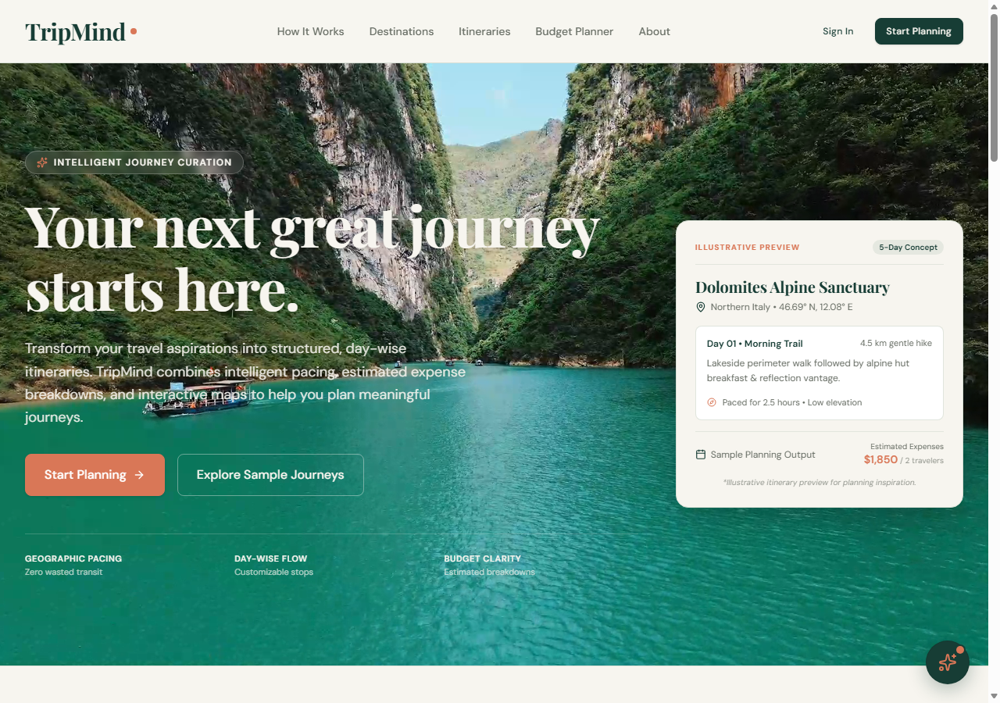
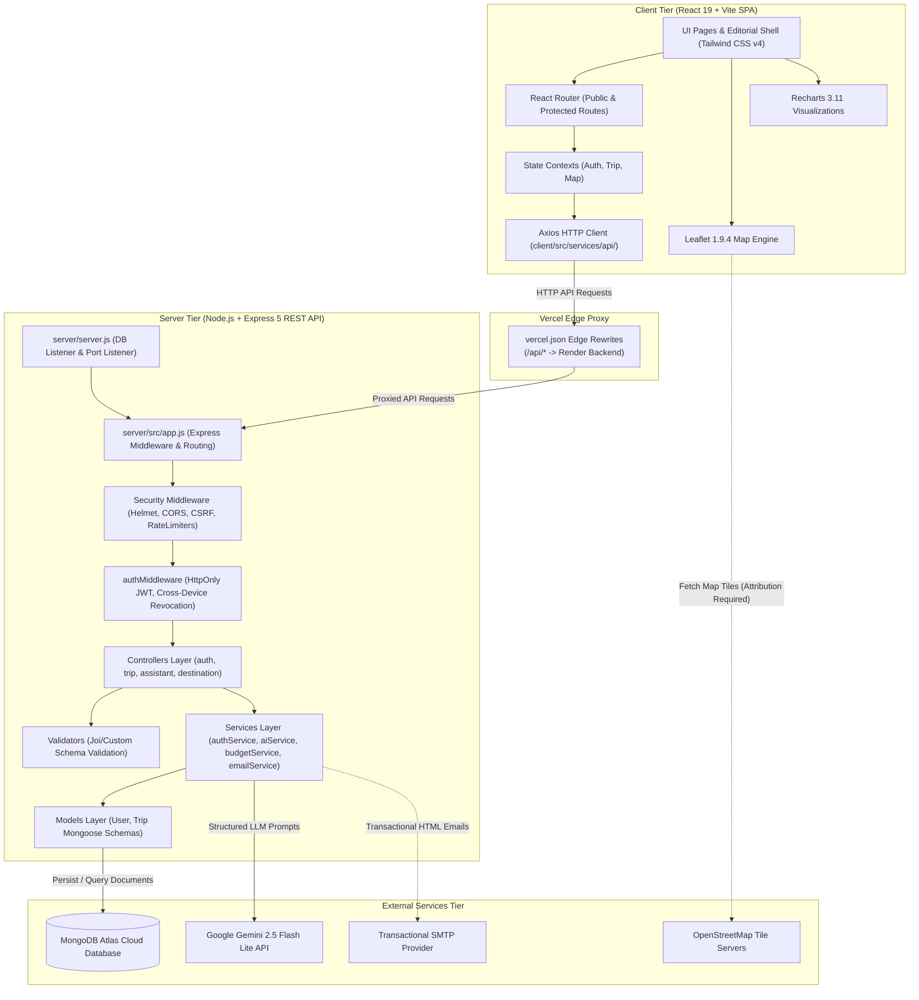
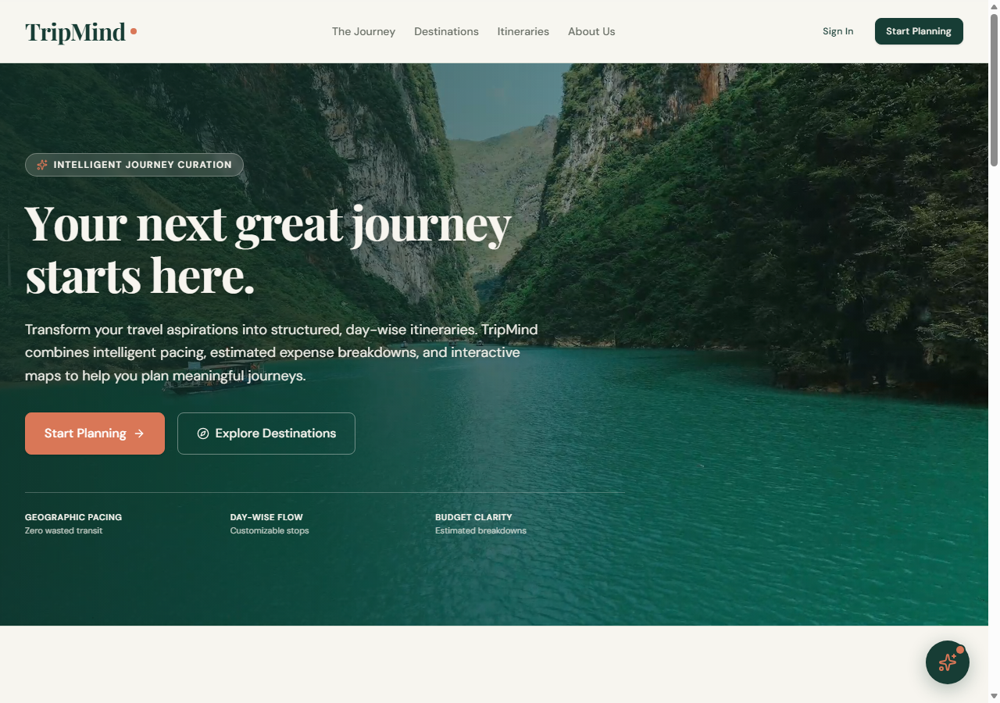
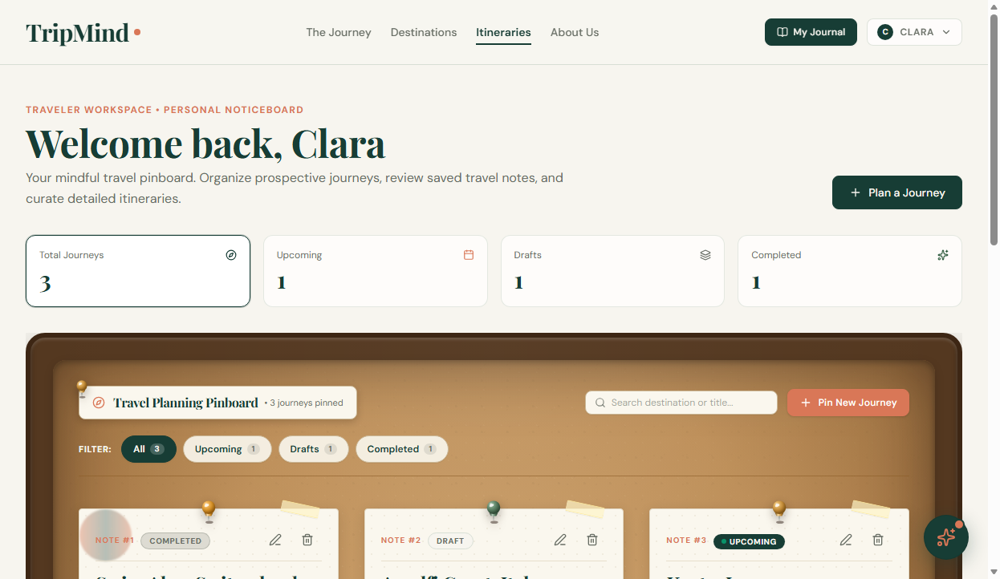
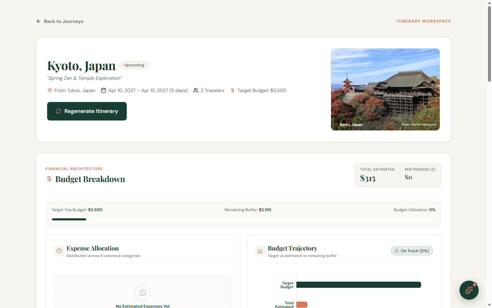
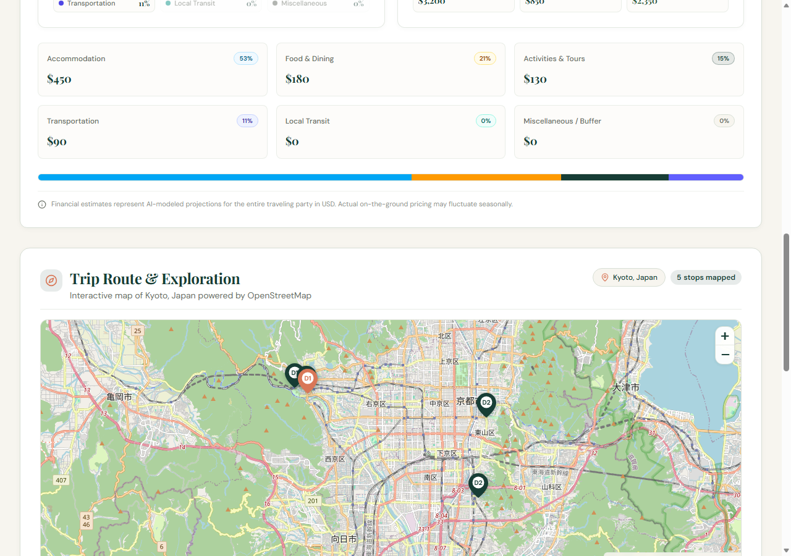
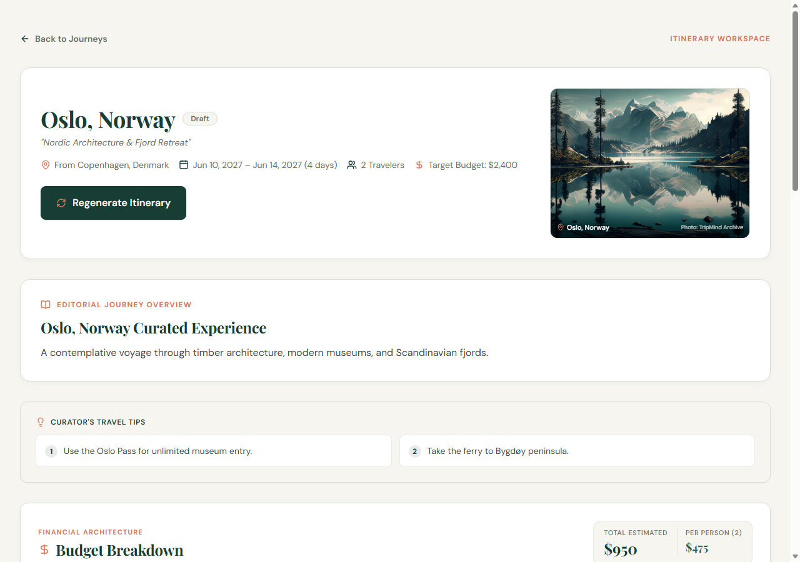
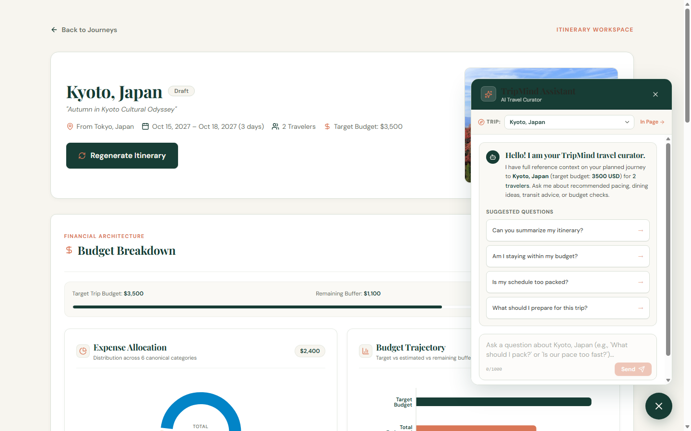
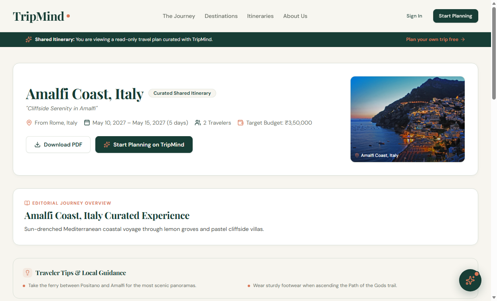
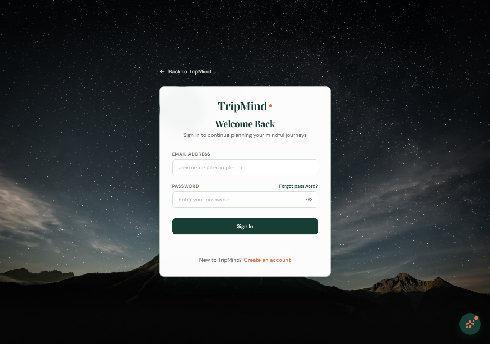

# TripMind — Mindful Travel, Thoughtfully Planned

<div align="center">



[](https://trip-mind-brown.vercel.app)
[](https://tripmind-0b2x.onrender.com/api/health)
[](https://www.mongodb.com/cloud/atlas)
[](https://ai.google.dev/)
[](https://react.dev/)
[](https://tailwindcss.com/)

**An AI-powered travel planning platform delivering a thoughtful, literary field-journal experience with structured daily itineraries, interactive map visualization, real-time budget analytics, and cryptographic sharing.**

[Explore Live Application](https://trip-mind-brown.vercel.app) • [GitHub Repository](https://github.com/abhijeet5423/TripMind) • [API Specification](docs/API.md) • [Database Architecture](docs/DATABASE.md)

</div>

---

## Table of Contents
- [1. Project Overview & Philosophy](#1-project-overview--philosophy)
- [2. Live Deployments & Repository Links](#2-live-deployments--repository-links)
- [3. Key Features & Capabilities](#3-key-features--capabilities)
- [4. Technology Stack](#4-technology-stack)
- [5. System Architecture](#5-system-architecture)
- [6. Repository Structure](#6-repository-structure)
- [7. Authentication & Security Architecture](#7-authentication--security-architecture)
- [8. AI Itinerary Generation Workflow](#8-ai-itinerary-generation-workflow)
- [9. Trip Management & Activity Editing](#9-trip-management--activity-editing)
- [10. Interactive Maps & Destination Discovery](#10-interactive-maps--destination-discovery)
- [11. Budget Analytics & Visualizations](#11-budget-analytics--visualizations)
- [12. PDF Export & Cryptographic Sharing](#12-pdf-export--cryptographic-sharing)
- [13. Email Verification & Password Recovery](#13-email-verification--password-recovery)
- [14. Database Models & Schema Design](#14-database-models--schema-design)
- [15. API Overview](#15-api-overview)
- [16. Local Installation & Development Setup](#16-local-installation--development-setup)
- [17. Environment Variable Configuration](#17-environment-variable-configuration)
- [18. Startup & Build Commands](#18-startup--build-commands)
- [19. Production Deployment Architecture](#19-production-deployment-architecture)
- [20. Current Limitations & Roadmap](#20-current-limitations--roadmap)
- [21. Verified Visual Showcase (Screenshots)](#21-verified-visual-showcase-screenshots)
- [22. Credits & Third-Party Attributions](#22-credits--third-party-attributions)

---

## 1. Project Overview & Philosophy

Travel planning is notoriously fragmented. Travelers bounce between dozens of open browser tabs, blog posts, disjointed note apps, spreadsheets, and navigation tools. Generic conversational AI assistants can list attractions, but they lack geographical proximity clustering, schedule pacing, itemized budget math, and spatial clarity.

**TripMind** solves these challenges by combining generative artificial intelligence with an intuitive, structured itinerary canvas. It transforms abstract travel ideas into actionable, day-wise itineraries complete with interactive Leaflet maps, itemized Recharts budget breakdowns, contextual AI assistance, and printable travel guides.

### Design Direction: Literary Travel Journal
TripMind deliberately rejects generic "dark SaaS dashboards", aggressive neon gradients, and cookie-cutter widgets. Instead, it embodies a **premium editorial travel aesthetic** inspired by vintage field guides, independent travel publications (*Cereal*, *Kinfolk*, *Condé Nast Traveler*), and tactile paper goods:
- **Warm Ivory Palette (`#F7F5EF`):** Soft, grounding surface tone replacing sterile digital white.
- **Deep Forest Green (`#173D35`):** Authoritative brand color representing quiet confidence.
- **Terracotta Accents (`#D97757`):** Earthy warmth reserved for deliberate call-to-actions.
- **Muted Sage (`#D8DFD5`):** Subtle borders and card outlines echoing dried botanical paper.
- **Editorial Typography:** High-contrast serif headlines paired with clean, geometric sans-serif text.

---

## 2. Live Deployments & Repository Links

- **Production Web Application (Vercel):** [https://trip-mind-brown.vercel.app](https://trip-mind-brown.vercel.app)
- **Production REST API (Render):** [https://tripmind-0b2x.onrender.com](https://tripmind-0b2x.onrender.com)
- **API Health Check:** [https://tripmind-0b2x.onrender.com/api/health](https://tripmind-0b2x.onrender.com/api/health)
- **Source Code Repository:** [https://github.com/abhijeet5423/TripMind](https://github.com/abhijeet5423/TripMind)

---

## 3. Key Features & Capabilities

- 🤖 **Structured AI Itinerary Generation:** Generates multi-day, geographically clustered itineraries using Google Gemini 2.5 Flash Lite mediated via backend schemas, with zero risk of malformed JSON.
- 🗺️ **Interactive Leaflet & OpenStreetMap Visualizer:** Pinpoints every activity with category-colored SVG teardrop pins, micro-offset disambiguation, and XSS-sanitized editorial popups.
- 📊 **Itemized Budget Analytics:** Computes expenditures across 6 canonical categories with Recharts Donut charts and Budget Comparison headroom bars.
- 💬 **Context-Aware AI Travel Assistant:** Bounded, trip-grounded conversational advisor answering questions about food, packing, local customs, and transit.
- ✏️ **Granular Activity CRUD:** Add, edit, or delete activities on any itinerary day with automatic mathematical budget reconciliation.
- 🔒 **Cryptographic Itinerary Sharing:** Generates high-entropy 256-bit public share links with AES-256-GCM encryption at rest, SHA-256 indexing, and optional budget masking.
- 📄 **Client-Side PDF Export:** Clean, multi-page print-optimized travel journal ready for offline travel or paper printing.
- 🛡️ **Enterprise-Grade Authentication:** HttpOnly session cookies, single-point bcrypt hashing, cross-device session invalidation on password reset, anti-enumeration defenses, and CSRF protection.
- 📱 **Mobile & Tablet Responsive:** Fluid multi-viewport experience with native CSS horizontal carousels, responsive drawers, and minimum 44px touch targets.

---

## 4. Technology Stack

### Client Tier (SPA)
| Technology | Version | Purpose & Rationale |
| :--- | :---: | :--- |
| **React** | `19.3.1` | Concurrent rendering engine and component modularity |
| **Vite** | `8.3.6` | Next-generation build tool with instant HMR and optimized tree-shaking |
| **Tailwind CSS** | `v4.3.5` | CSS-first `@theme` design tokens and utility-first styling |
| **React Router** | `7.18.5` | Declarative client-side routing with protected route boundaries |
| **Axios** | `1.21.1` | Promise-based HTTP client with credentials and interceptors |
| **Motion** | `14.14.0` | Motion graphics with strict `prefers-reduced-motion` compliance |
| **Leaflet** | `1.9.4` | Mobile-friendly interactive map rendering engine |
| **Recharts** | `3.11.0` | Declarative D3-based charting components for budget visualization |
| **Lucide React** | `1.72.0` | Consistent, accessible editorial iconography |

### Server Tier (REST API)
| Technology | Version | Purpose & Rationale |
| :--- | :---: | :--- |
| **Node.js** | `>=20.x` | Non-blocking asynchronous JavaScript server runtime |
| **Express** | `5.3.0` | Fast REST API framework with decoupled controller/service design |
| **Mongoose** | `9.12.1` | Strict ODM schema modeling and MongoDB database interface |
| **@google/genai** | `3.6.1` | Official Google GenAI SDK for Gemini 2.5 Flash Lite integration |
| **jsonwebtoken**| `9.0.3` | Cryptographic JWT signing and stateless session token verification |
| **bcrypt** | `6.0.0` | Single-point salted password hashing (10 rounds) |
| **Helmet** | `8.3.0` | Security headers (CSP, CORP, HSTS, frameguard, X-Content-Type) |
| **Nodemailer** | `10.6.1` | Transactional email delivery for verification and password recovery |
| **cookie-parser**| `1.4.7` | Parses incoming HttpOnly cookie headers |
| **cors** | `2.8.6` | Dynamic origin evaluation and credential support |

### Database & Cloud Infrastructure
- **MongoDB Atlas:** Managed cloud document database with independent `users` and `trips` collections.
- **OpenStreetMap:** Raster map tile server providing geographic tiles under ODbL license.
- **Vercel:** Edge CDN hosting the React SPA with same-origin `/api` rewrite proxy rules.
- **Render:** Cloud container hosting the Express REST API web service.

---

## 5. System Architecture



---

## 6. Repository Structure

```
TripMind/
├── client/                               # Frontend Single-Page Application (React 19 + Vite)
│   ├── public/                           # Static assets, SVG icons, favicon
│   ├── src/
│   │   ├── assets/                       # Curated WebP destination photography & videos
│   │   ├── components/                   # Modular React components
│   │   │   ├── assistant/                # AI Travel Assistant chat & global launcher
│   │   │   ├── budget/                   # Recharts Donut & Budget Comparison charts
│   │   │   ├── common/                   # Reusable UI controls (BorderTrail, buttons, modals)
│   │   │   ├── core/                     # Route guards (ProtectedRoute, PublicOnlyRoute)
│   │   │   ├── dashboard/                # Trip cards, filter pills, empty states
│   │   │   ├── itinerary/                # Day selector, activity cards, edit modals
│   │   │   ├── landing/                  # Hero, storytelling, destination showcase
│   │   │   ├── layout/                   # Navbar, Footer, PageShell
│   │   │   └── map/                      # LeafletMapContainer & SVG ActivityMarkers
│   │   ├── context/                      # React 19 Contexts (AuthContext, TripContext, MapContext)
│   │   ├── pages/                        # Route pages (Landing, Dashboard, TripDetail, Auth...)
│   │   ├── services/api/                 # Axios clients (apiClient, authApi, tripApi, assistantApi...)
│   │   ├── utils/                        # Pure formatters, map helpers, error mappers
│   │   ├── App.jsx                       # Master route registration & providers
│   │   ├── index.css                     # Tailwind CSS v4 CSS-first @theme design tokens
│   │   └── main.jsx                      # DOM mount entry point
│   ├── index.html                        # HTML5 shell with editorial typography fonts
│   ├── package.json                      # Frontend dependencies & scripts
│   ├── vercel.json                       # Vercel Edge reverse proxy rewrites
│   └── vite.config.js                    # Vite configuration
│
├── server/                               # Backend REST API (Node.js + Express 5)
│   ├── server.js                         # Application entry point, DB listener & graceful shutdown
│   ├── src/
│   │   ├── app.js                        # Express app configuration, middleware pipeline & routes
│   │   ├── config/                       # DB connection, Gemini client, env validator
│   │   ├── controllers/                  # HTTP request controllers (auth, trip, assistant...)
│   │   ├── data/                         # Static curated destination data
│   │   ├── middleware/                   # authMiddleware, csrfProtection, rateLimiter, errorHandler
│   │   ├── models/                       # Mongoose ODM schemas (User.js, Trip.js)
│   │   ├── routes/                       # Route declarations (auth, trip, assistant, destination...)
│   │   ├── schemas/                      # Typed JSON schemas for Gemini structured outputs
│   │   ├── services/                     # Business logic (aiService, budgetService, emailService...)
│   │   ├── utils/                        # Crypto tokens, password hashing, JWT sign/verify
│   │   └── validators/                   # Schema validation middleware (Joi/custom)
│   ├── .env.example                      # Server environment variable template
│   └── package.json                      # Backend dependencies & scripts
│
├── docs/                                 # Detailed Technical Documentation & Assets
│   ├── API.md                            # Complete REST API specification
│   ├── DATABASE.md                       # Comprehensive MongoDB schema reference
│   └── screenshots/                      # 12 Verified application screenshots
│
├── ARCHITECTURE.md                       # System Architecture & Technical Design baseline
├── DECISIONS.md                          # Confirmed Architecture Decision Records (ADRs)
├── DEVELOPMENT_LOG.md                    # Dated chronological engineering progress log
├── MVP_SCOPE.md                          # Feature scope categorization & roadmap status
├── PROJECT_CONTEXT.md                    # High-level mission, target audience & value props
├── PROJECT_RULES.md                      # Mandatory coding conventions & operational boundaries
├── UI_DESIGN_SYSTEM.md                   # Visual design system, palette tokens & typography
├── UI_MOTION_GUIDELINES.md               # Motion animation principles & timing tiers
├── .gitignore                            # Git exclusion rules
└── README.md                             # Project documentation (this file)
```

---

## 7. Authentication & Security Architecture

TripMind implements a defense-in-depth security architecture complying with OWASP standards:

### 1. Stateless HttpOnly Cookie Architecture ([ADR-010](DECISIONS.md))
- JWT access tokens (15-minute lifespan) are stored exclusively in HttpOnly, SameSite, Secure cookies.
- JavaScript running in the browser cannot read or exfiltrate session tokens via XSS.

### 2. Cross-Device Session Invalidation (Day 54 Closeout)
- When a traveler resets their password, `user.passwordChangedAt = new Date()` is recorded in MongoDB.
- On every authenticated request, `authenticateToken` middleware compares the JWT issuance timestamp (`iat`) against `user.changedPasswordAfter(decoded.iat)`.
- Stale tokens issued prior to the password reset are rejected across all devices with HTTP 401 `UNAUTHORIZED` (`Password was recently changed. Please log in again.`), achieving global session revocation without Redis or stateful session tables.

### 3. Single-Point Password Hashing ([ADR-004](DECISIONS.md))
- Salted bcrypt hashing (10 salt rounds) is executed in exactly one place: the Mongoose `User.pre('save')` hook.
- Controller and service layers handle raw passwords, eliminating double-hashing regressions.

### 4. CSRF Protection & Multi-Origin CORS ([ADR-030](DECISIONS.md))
- Mutating endpoints (`POST`, `PUT`, `PATCH`, `DELETE`) are guarded by `csrfProtection` middleware validating incoming `Origin` and `Referer` headers against trusted domains.
- CORS preflight dynamically permits credentials for `https://trip-mind-brown.vercel.app`, Vercel preview environments, and local development.

### 5. Multi-Tier Sliding Rate Limiting
- Independent in-memory rate limiters protect authentication endpoints (10 req/15m), password recovery (5 req/15m), AI generation (15 req/min), and public shared links (60 req/min).

### 6. Anti-Enumeration Defensive Contracting
- `POST /api/auth/login` returns uniform generic error messages ("Invalid email or password") for unknown emails and wrong passwords.
- `POST /api/auth/forgot-password` and `POST /api/auth/resend-verification` return identical generic HTTP 200 responses regardless of whether the email exists.
- Cross-user resource access returns uniform HTTP 404 `NOT_FOUND` to prevent IDOR resource enumeration.

---

## 8. AI Itinerary Generation Workflow

TripMind uses a robust, two-tier validation workflow mediating between Google Gemini and MongoDB:

```
[ Traveler Inputs Trip Basics (Destination, Dates, Budget, Style, Interests) ]
                                    │
                                    ▼
[ Backend Assembles Structured Context: buildTripContext() in aiService.js ]
                                    │
                                    ▼
[ Google Gemini 2.5 Flash Lite API (gemini-3.5-flash-lite via @google/genai) ]
  ├── Master System Instruction (Editorial travel persona, geography clustering)
  └── Structured Schema Enforcement (responseMimeType: 'application/json')
                                    │
                                    ▼
[ Raw AI Output Parsing (Zero hallucinated JSON envelope formatting) ]
                                    │
                                    ▼
[ Tier-2 Semantic Validation: itineraryValidator.js ]
  ├── Verifies sequential calendar continuity matching departure/return dates
  ├── Reconciles itemized 6-category budget math with total estimates
  ├── Enforces activity density rules (2–8 activities per day)
  └── Validates mutually dependent WGS84 geographic coordinates
                                    │
                   ┌────────────────┴────────────────┐
             Valid │                                 │ Invalid / Failed
                   ▼                                 ▼
[ Atomic MongoDB Update via Mongoose ]   [ Reject with 422 Validation Error ]
  ├── Updates trip.days embedded docs      └── Existing itinerary 100% PRESERVED
  ├── Updates trip.budgetSummary math          (Zero destructive overwrites)
  └── Updates editorial summary & tips
```

---

## 9. Trip Management & Activity Editing

- **Full Lifecycle CRUD:** Create trips from the guided wizard, view paginated journeys on the dashboard, update travel preferences via tabbed modals, and delete trips with safe confirmation dialogs.
- **Embedded Subdocument Architecture:** Itinerary days and activities live directly within the parent `Trip` document. Deleting a trip permanently erases all associated days and stops in a single transaction without leaving orphaned records.
- **Granular Activity Manipulation:**
  - Add activities to any day (`POST /api/trips/:id/activities`).
  - Edit activity details, timing, or coordinates (`PATCH /api/trips/:id/days/:dayId/activities/:activityId`).
  - Remove activities (`DELETE /api/trips/:id/days/:dayId/activities/:activityId`).
- **Dynamic Budget Recalculation:** Centralized `budgetService.recalculateTripBudget()` automatically re-sums all activity costs, updates categorical allocations, and recalibrates remaining budget headroom upon any activity change.

---

## 10. Interactive Maps & Destination Discovery

### Interactive Leaflet & OpenStreetMap Engine
- **Component Lifecycle:** Self-contained `LeafletMapContainer.jsx` binds to a DOM container ref with React Fast Refresh isolation.
- **Dynamic Activity Markers:** `ActivityMarkers.jsx` orchestrates an internal `L.layerGroup`, clearing and remounting custom SVG pins when itinerary days change without tearing down the underlying map.
- **Custom SVG Teardrop Pins:** Crisp, standalone vector pins (32x40px) color-coded to match the 5 Mongoose schema categories:
  - 🏨 **Stay (`#173D35` - Forest Green)**
  - 🍽️ **Food (`#D97757` - Terracotta)**
  - 🏛️ **Activity (`#C28B38` - Ochre Gold)**
  - 🚆 **Transit (`#2E5B3D` - Olive Grove)**
  - 📌 **Other (`#686E65` - Stone Gray)**
- **Micro-Offset Disambiguation:** When multiple stops share identical geographic coordinates, subsequent markers receive a circular micro-offset (~7m), keeping all pins distinct and clickable while preserving exact text in popups.
- **OWASP-Compliant Popups:** Activity titles, locations, and notes pass through `escapeHtml()` before string interpolation into Leaflet popups, eliminating DOM-based XSS vectors.

### Curated Destination Discovery Grid
- 6 hand-curated destinations (Kyoto, Swiss Alps, Bali, Manali, Varanasi, Amalfi Coast) with WebP photography, travel vibes, and daily budget estimates.
- Debounced multi-field search (matching name, country, and tags) synchronized with responsive category filter pills.

---

## 11. Budget Analytics & Visualizations

TripMind incorporates declarative, responsive data visualizations powered by **Recharts**:

### 1. Expense Donut Chart (`ExpenseDonutChart.jsx`)
- Visualizes categorical expenditure distribution across the 6 canonical categories.
- Centered summary pill displays total estimated spending in the trip currency.
- Custom styled tooltip renders category proportions and formatted currency values.

### 2. Budget Comparison Bar Chart (`BudgetComparisonChart.jsx`)
- Horizontal comparative bar chart benchmarking Target Budget, Total Estimated Expenses, and Remaining Buffer.
- **Over-Budget Warning System:** If estimated expenses exceed the target budget, the estimated bar shifts to Burnt Crimson (`#B33A3A`) and displays an over-budget headroom warning.

### 3. Canonical Category Discipline
- Strictly partitions spending across 6 canonical categories: Accommodation, Food & Beverage, Transportation, Activities, Local Transit, and Miscellaneous. All financial figures are derived authoritatively from the backend `trip.budgetSummary` model.

---

## 12. PDF Export & Cryptographic Sharing

### Cryptographic Public Sharing ([ADR-030](DECISIONS.md))
- **Entropy & Key Storage:** Generates a 32-byte (256-bit) cryptographically random token (`crypto.randomBytes(32).toString('hex')`).
- **Indexed Lookup:** The token is stored in MongoDB exclusively as a SHA-256 hash with a sparse partial index (`{ isShared: true }`), allowing sub-millisecond retrieval.
- **AES-256-GCM Encryption at Rest:** The raw token is encrypted at rest using AES-256-GCM (`select: false`) so the trip owner can retrieve their active share URL without regenerating the token.
- **Instant Revocation:** Toggling sharing off immediately invalidates the token. Re-enabling sharing generates a brand-new token; previously revoked tokens return uniform 404s.
- **Data Minimization:** Public shared responses explicitly strip `userId`, internal credentials, and owner contact details. Budget visibility can be toggled off by the owner.

### Client-Side PDF Export
- Dedicated export route (`/trips/:id/export`) formatted with print CSS media queries (`@media print`).
- Generates clean, multi-page editorial travel guides with page breaks, header branding, itinerary stops, and travel notes.

---

## 13. Email Verification & Password Recovery

Implemented during the Day 54 upgrade with strict cryptographic integrity:

- **Email Verification:** Newly registered accounts begin with `isEmailVerified: false` and are blocked from logging in (HTTP 403 `EMAIL_NOT_VERIFIED`) until verified.
- **Single-Use Verification Tokens:** 24-hour verification links consumed via atomic MongoDB `$unset` operations.
- **Self-Service Password Reset:** 30-minute recovery links storing only SHA-256 hashes in MongoDB. Consuming the token updates the password via the single-point bcrypt hook, clears the token fields, and sets `passwordChangedAt`.
- **Legacy Compatibility:** Pre-existing MongoDB Atlas documents (where `isEmailVerified` is `undefined`) are grandfathered in, retaining immediate login access without requiring database migrations.
- **Editorial HTML Email Templates:** Transactional emails styled with TripMind's warm ivory palette (`#F7F5EF`), forest green buttons (`#173D35`), fallback URLs, and clear expiration notices.

---

## 14. Database Models & Schema Design

TripMind utilizes MongoDB Atlas with two primary collections. Complete schema specifications, field types, and index definitions are documented in [docs/DATABASE.md](docs/DATABASE.md).

### Summary Schema Architecture
- **`users` Collection:** Stores user identity, normalized email, bcrypt password hash (`select: false`), role (`user`/`admin`), email verification status, cryptographic token hashes, and `passwordChangedAt` timestamp.
- **`trips` Collection:** Aggregate root containing traveler reference (`userId`), destination metadata, travel style preferences, embedded `days` array, embedded `budgetSummary`, and embedded `shareSettings`.
  - **Embedded `days[]`:** Sequential daily schedules containing day number, date, theme, and embedded `activities[]`.
  - **Embedded `activities[]`:** Chronological stops containing time, time slot, title, description, category, cost, and WGS84 coordinates.
  - **Embedded `budgetSummary`:** Real-time itemized categorical spending summary.
  - **Embedded `shareSettings`:** Public sharing flags, SHA-256 share token hash, and AES-256-GCM encrypted share token.

---

## 15. API Overview

TripMind's backend exposes a comprehensive RESTful API adhering to the standardized `{ success, data, message }` JSON envelope. Complete endpoint details, request/response payloads, and error codes are documented in [docs/API.md](docs/API.md).

| Category | Endpoint | Method | Auth | Description |
| :--- | :--- | :---: | :---: | :--- |
| **Auth** | `/api/auth/register` | `POST` | Public | Register new traveler account (sends verification email) |
| **Auth** | `/api/auth/login` | `POST` | Public | Authenticate user & issue HttpOnly session cookie |
| **Auth** | `/api/auth/logout` | `POST` | Public | Terminate session & clear HttpOnly cookie |
| **Auth** | `/api/auth/me` | `GET` | User | Retrieve current authenticated user profile |
| **Auth** | `/api/auth/verify-email` | `POST` | Public | Consume single-use email verification token |
| **Auth** | `/api/auth/resend-verification` | `POST` | Public | Request fresh verification link (anti-enumeration) |
| **Auth** | `/api/auth/forgot-password` | `POST` | Public | Initiate password reset link (anti-enumeration) |
| **Auth** | `/api/auth/reset-password` | `POST` | Public | Complete password reset & revoke prior sessions |
| **Trips** | `/api/trips` | `POST` | User | Create a new trip |
| **Trips** | `/api/trips` | `GET` | User | List user-owned trips (paginated, sorted, filtered) |
| **Trips** | `/api/trips/:id` | `GET` | User | Retrieve single trip with all days and activities |
| **Trips** | `/api/trips/:id` | `PATCH` | User | Update trip metadata |
| **Trips** | `/api/trips/:id` | `DELETE` | User | Permanently delete trip and all subdocuments |
| **AI** | `/api/trips/:id/generate-itinerary` | `POST` | User | Generate & persist AI itinerary using Gemini |
| **Activities** | `/api/trips/:id/activities` | `POST` | User | Add activity to a day & recalculate budget |
| **Activities** | `/api/trips/:id/days/:dayId/activities/:activityId` | `PATCH` | User | Edit activity & recalculate budget |
| **Activities** | `/api/trips/:id/days/:dayId/activities/:activityId` | `DELETE` | User | Delete activity & recalculate budget |
| **Share** | `/api/trips/:id/share` | `GET` | User | Retrieve active share settings & token (owner only) |
| **Share** | `/api/trips/:id/share` | `POST` | User | Enable, disable, or update share settings |
| **Share** | `/api/trips/shared/:token` | `GET` | Public | Retrieve sanitized public read-only itinerary |
| **Assistant** | `/api/assistant/messages` | `POST` | User | Context-aware AI trip assistant message |
| **Discovery** | `/api/destinations` | `GET` | Public | List curated destination cards with search & filter |
| **Discovery** | `/api/destinations/:identifier` | `GET` | Public | Retrieve single destination details |
| **System** | `/api/health` | `GET` | Public | Service health status and MongoDB connection check |

---

## 16. Local Installation & Development Setup

### Prerequisites
- **Node.js:** Version `20.x` or higher
- **npm:** Version `10.x` or higher
- **MongoDB:** Local MongoDB Community Server (`mongodb://127.0.0.1:27017/tripmind`) or a free [MongoDB Atlas](https://www.mongodb.com/cloud/atlas) cluster connection string.
- **Google Gemini API Key:** Free-tier API key from [Google AI Studio](https://aistudio.google.com/).

### Installation Steps

1. **Clone the Repository:**
   ```bash
   git clone https://github.com/abhijeet5423/TripMind.git
   cd TripMind
   ```

2. **Install Server Dependencies:**
   ```bash
   cd server
   npm install
   ```

3. **Install Client Dependencies:**
   ```bash
   cd ../client
   npm install
   ```

---

## 17. Environment Variable Configuration

### Server Configuration (`server/.env`)
Create a `.env` file in the `server/` directory based on `server/.env.example`:

```env
# Server Runtime
PORT=5000
NODE_ENV=development

# Database Connection (MongoDB Atlas or Local MongoDB)
MONGODB_URI=mongodb+srv://<username>:<password>@cluster.mongodb.net/tripmind?retryWrites=true&w=majority

# JWT Stateless Authentication
JWT_SECRET=your_high_entropy_jwt_secret_at_least_32_characters

# Client Application URL (For CORS & Cookie Domain Resolution)
CLIENT_URL=http://localhost:5173

# Google Gemini AI Configuration (Free Tier)
GEMINI_API_KEY=your_gemini_api_key_here
GEMINI_MODEL=gemini-3.5-flash-lite

# Reverse Proxy Trust (1 hop for Render / Vercel edge proxy)
TRUST_PROXY=1

# Transactional SMTP Delivery (Optional for local development; required for production email delivery)
SMTP_HOST=smtp.example.com
SMTP_PORT=587
SMTP_SECURE=false
SMTP_USER=your_smtp_user
SMTP_PASS=your_smtp_password
EMAIL_FROM="TripMind <no-reply@tripmind.com>"
```

### Client Configuration (`client/.env`)
Create an optional `.env` file in the `client/` directory for local development:

```env
# Optional: In development, defaults to http://localhost:5000/api if omitted
VITE_API_URL=http://localhost:5000/api
```

---

## 18. Startup & Build Commands

### 1. Start the Backend API Server
In the `server/` directory:
```bash
# Start development server with auto-reload (nodemon)
npm run dev

# Start production server
npm start

# Verify Gemini AI connection
npm run verify:gemini
```
*The API will be accessible at `http://localhost:5000/api`.*

### 2. Start the Frontend Client
In a separate terminal, navigate to the `client/` directory:
```bash
# Start Vite development server
npm run dev

# Run ESLint validation
npm run lint

# Compile optimized production bundle
npm run build

# Preview production build locally
npm run preview
```
*The web application will open at `http://localhost:5173`.*

---

## 19. Production Deployment Architecture

TripMind employs a decoupled cloud deployment:

```
[ Browser / Traveler ]
          │
          ▼
[ Vercel Edge CDN (Frontend SPA) ]
  ├── Hosts compiled React 19 production bundle
  ├── Handles client-side React Router navigation (/(.*) -> /index.html)
  └── Edge Reverse Proxy: /api/:path* -> https://tripmind-0b2x.onrender.com/api/:path*
          │
          ▼
[ Render Web Service (Backend REST API) ]
  ├── Runs Node.js / Express 5 listener on Linux container
  ├── Enforces Helmet security headers & dynamic CORS allowlist
  ├── Executes authenticateToken, csrfProtection, and rate limiters
  └── Handles business logic, AI prompts, and email queues
          │
          ├─────────────────────────┐
          ▼                         ▼
[ MongoDB Atlas Cluster ]     [ Google Gemini AI Studio ]
  (Independent Collections      (gemini-3.5-flash-lite via
   with Embedded Subdocs)        official @google/genai SDK)
```

### Same-Origin Edge Proxy Benefit
Because Vercel proxies `/api/*` directly to Render at the network edge, browser requests remain **first-party same-origin** to the client domain (`*.vercel.app`). This completely avoids third-party cross-site cookie blocking on modern browsers (Safari ITP, Chrome Privacy Sandbox) while eliminating CORS preflight overhead on API traffic.

---

## 20. Current Limitations & Roadmap

### Current Limitations
1. **SMTP Production Configuration Pending:** Real email delivery (verification emails and password reset links) is awaiting deployment of live production SMTP provider credentials (`SMTP_HOST`, `SMTP_PORT`, `SMTP_USER`, `SMTP_PASS`) on the production hosting environment. All authentication and recovery logic is fully implemented and passes 103 automated tests using test mock transports.
2. **Single-User Trip Planning:** Real-time multi-user collaborative editing via WebSockets or CRDTs is not supported in the MVP. Itineraries can be shared publicly via read-only cryptographic links.
3. **Offline Raster Tiles:** Interactive maps require an active internet connection to stream OpenStreetMap raster tiles.

### Future Roadmap (Tier 2 & Tier 3)
- [ ] Live flight and accommodation booking integrations (Amadeus / Skyscanner APIs).
- [ ] Real-time collaborative itinerary editing with traveler permission tiers.
- [ ] Offline PWA tile caching and service worker synchronization.
- [ ] Multi-day localized weather forecast preview for upcoming trip dates.
- [ ] Packing checklist generator customized by climate, duration, and activities.
- [ ] Social OAuth authentication (Google Sign-In / Apple ID).

---

## 21. Verified Visual Showcase (Screenshots)

All screenshots below were captured during automated Chrome DevTools Protocol (CDP) and headless browser verification suites:

### 1. Editorial Landing Page & Hero


### 2. Homepage Storytelling Section ("From Inspiration to Itinerary")


### 3. Dedicated About Us Page


### 4. Traveler Dashboard with Search & Multi-Status Filter Pills


### 5. Day-by-Day Itinerary Planning Workspace


### 6. Interactive Leaflet Map with Category SVG Pins


### 7. Recharts Budget Analytics (Expense Donut & Comparison Bars)


### 8. Context-Aware AI Travel Assistant


### 9. Public Cryptographic Shareable Itinerary


### 10. Print-Optimized PDF Export Preview


### 11. Authentication Login with Forest Green BorderTrail


### 12. Self-Service Password Recovery


---

## 22. Credits & Third-Party Attributions

TripMind is crafted with gratitude to the open-source community and content contributors:

- **Generative AI Provider:** Powered by the [Google Gemini API](https://ai.google.dev/) using `@google/genai` and model `gemini-3.5-flash-lite`.
- **Map Data & Raster Tiles:** Map data `© OpenStreetMap contributors` available under the [Open Database License (ODbL)](https://www.openstreetmap.org/copyright). Rendered using [Leaflet](https://leafletjs.com/).
- **Curated Destination Photography (Unsplash):**
  - *Kyoto, Japan:* Photo by **Su San Lee** on [Unsplash](https://unsplash.com)
  - *Swiss Alps, Switzerland:* Photo by **Dino Reichmuth** on [Unsplash](https://unsplash.com)
  - *Bali, Indonesia:* Photo by **Oliver Sjöström** on [Unsplash](https://unsplash.com)
  - *Manali, India:* Photo by **Sanjay K** on [Unsplash](https://unsplash.com)
  - *Varanasi, India:* Photo by **Pratik Gupta** on [Unsplash](https://unsplash.com)
  - *Amalfi Coast, Italy:* Photo by **Reiseuhu** on [Unsplash](https://unsplash.com)
- **Component Icons:** Provided by [Lucide Icons](https://lucide.dev/).
- **Typography:** Serif headlines and geometric body typography powered by Google Fonts.

---

<div align="center">

**TripMind** — *Ready. Steady. Go.*  
Thoughtfully planned journeys for mindful travelers.

</div>
