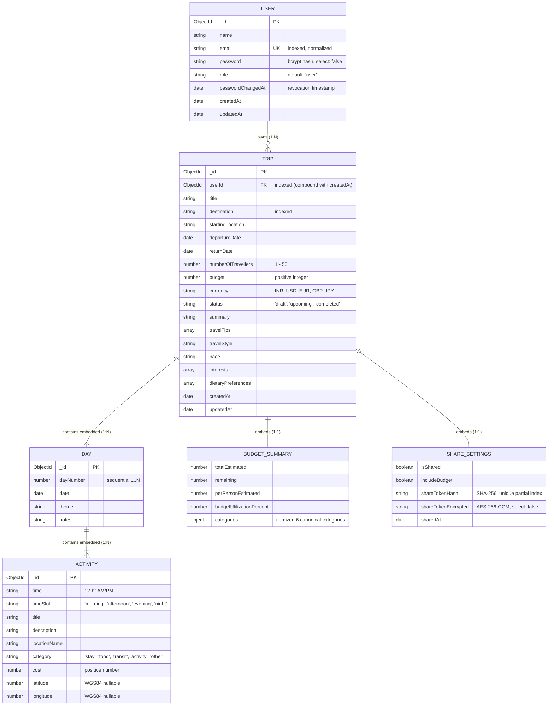

# TripMind — Database Architecture & Schema Specification

> **Engine:** MongoDB (v6.0+ / MongoDB Atlas)  
> **ODM:** Mongoose (v9.x)  
> **Topology:** Decoupled Collections (`users`, `trips`) with Embedded Subdocument Arrays for Days, Activities, and Financial Summaries.

---

## 1. Entity-Relationship Overview

---

## 2. Collection Schemas

### 2.1 `users` Collection (`server/src/models/User.js`)

Manages traveler accounts, authentication credentials, and cryptographic recovery tokens.

#### Field Definitions
| Field | Type | Required | Default | Modifiers & Notes |
| :--- | :---: | :---: | :---: | :--- |
| `_id` | `ObjectId` | Auto | Auto | MongoDB primary key. |
| `name` | `String` | Yes | — | Trimmed, 2–100 characters. |
| `email` | `String` | Yes | — | Trimmed, lowercase, unique index, max 255 chars. |
| `password` | `String` | Yes | — | Stored as bcrypt hash (10 salt rounds). Hidden from queries (`select: false`). |
| `role` | `String` | Yes | `'user'` | Enum: `['user', 'admin']`. Protected from client mutation. |
| `passwordChangedAt` | `Date` | No | — | Timestamp set on password change. Compared against JWT `iat` to invalidate stale sessions. |
| `createdAt` | `Date` | Auto | `now` | Managed via `{ timestamps: true }`. |
| `updatedAt` | `Date` | Auto | `now` | Managed via `{ timestamps: true }`. |

#### Indexes
- `{ email: 1 }`: Unique index on normalized email.

#### Hooks & Methods
- **`pre('save')` Hook:** Enforces single-point password hashing using `bcrypt.hash(password, 10)` only when `isModified('password')` is true.
- **`methods.comparePassword(candidate)`:** Compares candidate plaintext against stored bcrypt hash.
- **`methods.changedPasswordAfter(jwtIat)`:** Returns `jwtIat < Math.floor(this.passwordChangedAt.getTime() / 1000)` to detect tokens issued prior to credential modification.
- **`toJSON` / `toObject` Transform:** Explicitly scrubs `password` and `__v`.

---

### 2.2 `trips` Collection (`server/src/models/Trip.js`)

Core aggregate root encapsulating journey metadata, daily schedules, itemized activities, real-time budget calculations, and share settings.

#### Top-Level Fields
| Field | Type | Required | Default | Notes |
| :--- | :---: | :---: | :---: | :--- |
| `_id` | `ObjectId` | Auto | Auto | MongoDB primary key. |
| `userId` | `ObjectId` | Yes | — | References `User._id`. Indexed for fast multi-tenant queries. |
| `title` | `String` | Yes | — | Trimmed, 2–150 characters. |
| `destination` | `String` | Yes | — | Destination city/region/country. Indexed. |
| `startingLocation` | `String` | Yes | — | Origin point for the traveler. |
| `departureDate` | `Date` | Yes | — | Start date of the trip. |
| `returnDate` | `Date` | Yes | — | End date (`returnDate >= departureDate`, max 30-day duration). |
| `numberOfTravellers` | `Number`| Yes | `1` | Integer between 1 and 50. |
| `budget` | `Number` | Yes | — | Positive numerical spending target. |
| `currency` | `String` | Yes | `'INR'` | Enum: `['INR', 'USD', 'EUR', 'GBP', 'JPY']`. |
| `status` | `String` | Yes | `'draft'` | Enum: `['draft', 'upcoming', 'completed']`. |
| `summary` | `String` | No | `''` | Editorial prose summary generated by AI or entered by traveler. |
| `travelTips` | `[String]` | No | `[]` | Array of actionable travel recommendations. |
| `travelStyle` | `String` | No | `''` | E.g., "Cultural & Immersive", "Luxury Leisure". |
| `pace` | `String` | No | `'Moderate'` | Enum: `['Relaxed', 'Moderate', 'Fast-paced']`. |
| `interests` | `[String]` | No | `[]` | Array of traveler interests (max 30 items). |
| `dietaryPreferences`| `[String]` | No | `[]` | Array of dietary restrictions (max 20 items). |
| `days` | `[Day]` | No | `[]` | Embedded subdocument array of itinerary days. |
| `budgetSummary` | `Object` | Yes | Default obj | Embedded subdocument tracking itemized expenses. |
| `shareSettings` | `Object` | Yes | Default obj | Embedded subdocument governing public access. |
| `createdAt` | `Date` | Auto | `now` | Managed via `{ timestamps: true }`. |
| `updatedAt` | `Date` | Auto | `now` | Managed via `{ timestamps: true }`. |

#### Indexes
- `{ userId: 1, createdAt: -1 }`: Compound index for paginated dashboard queries.
- `{ destination: 1 }`: Index supporting text filtering on destinations.
- `{ 'shareSettings.shareTokenHash': 1 }`: Sparse, unique partial filter index (`{ 'shareSettings.isShared': true }`) enabling sub-millisecond public share lookups.

---

### 2.3 Embedded Subdocuments

#### `DaySchema` (`trip.days[]`)
| Field | Type | Required | Notes |
| :--- | :---: | :---: | :--- |
| `_id` | `ObjectId` | Auto | Unique identifier for the itinerary day. |
| `dayNumber` | `Number` | Yes | 1-indexed sequential integer (1..30). |
| `date` | `Date` | Yes | Calendar date corresponding to the itinerary day. |
| `theme` | `String` | No | Descriptive daily narrative (e.g., "Arashiyama Bamboo & Zen Sanctuaries"). |
| `notes` | `String` | No | Optional traveler notes. |
| `activities` | `[Activity]` | No | Chronological array of scheduled stops (2–8 per day). |

#### `ActivitySchema` (`trip.days[].activities[]`)
| Field | Type | Required | Notes |
| :--- | :---: | :---: | :--- |
| `_id` | `ObjectId` | Auto | Subdocument primary key used for granular updates and deletion. |
| `time` | `String` | No | Human-readable 12-hour format (e.g., `'09:30 AM'`). |
| `timeSlot` | `String` | Yes | Enum: `['morning', 'afternoon', 'evening', 'night']`. |
| `title` | `String` | Yes | Name of activity/attraction (2–120 characters). |
| `description` | `String` | No | Curated description or context. |
| `locationName` | `String` | No | Landmark, neighborhood, or venue name. |
| `address` | `String` | No | Specific address or directions. |
| `category` | `String` | Yes | Enum: `['stay', 'food', 'transit', 'activity', 'other']`. Controls map pin color. |
| `cost` | `Number` | No | Estimated expenditure in trip currency (>= 0, default: `0`). |
| `latitude` | `Number` | No | WGS84 coordinate (-90 to +90). Mutually required with longitude. |
| `longitude` | `Number` | No | WGS84 coordinate (-180 to +180). Mutually required with latitude. |

#### `BudgetSummarySchema` (`trip.budgetSummary`)
| Field | Type | Required | Notes |
| :--- | :---: | :---: | :--- |
| `totalEstimated` | `Number` | Yes | Sum of all activity costs across all days. |
| `remaining` | `Number` | Yes | `Math.max(0, budget - totalEstimated)`. |
| `perPersonEstimated` | `Number` | Yes | `totalEstimated / numberOfTravellers`. |
| `budgetUtilizationPercent` | `Number` | Yes | `(totalEstimated / budget) * 100` (rounded to 1 decimal). |
| `categories` | `Object` | Yes | Map of 6 canonical categories: `accommodation`, `foodAndBeverage`, `transportation`, `activities`, `localTransport`, `miscellaneous`. |

#### `ShareSettingsSchema` (`trip.shareSettings`)
| Field | Type | Required | Default | Notes |
| :--- | :---: | :---: | :---: | :--- |
| `isShared` | `Boolean` | Yes | `false` | When `false`, public access returns uniform 404. |
| `includeBudget` | `Boolean` | Yes | `true` | When `false`, public responses scrub all financial fields. |
| `shareTokenHash` | `String` | No | — | SHA-256 hash of the 64-hex share token. |
| `shareTokenEncrypted` | `String` | No | — | AES-256-GCM encrypted raw token for owner retrieval (`select: false`). |
| `sharedAt` | `Date` | No | — | Timestamp when sharing was enabled. |

---

## 3. Data Integrity & Lifecycle Rules

1. **Atomic Document Persistence:**
   - Generating an itinerary replaces `days`, `budgetSummary`, `summary`, and `travelTips` within a single atomic Mongoose update. If validation fails, existing itineraries remain unmutated.
2. **Dynamic Financial Recalculation:**
   - Adding, editing, or deleting an activity invokes `budgetService.recalculateTripBudget(trip)`, ensuring categorical totals and headroom values are mathematically consistent before persisting.
3. **Cascading Erasure:**
   - Deleting a trip via `DELETE /api/trips/:id` permanently removes all associated days, activities, budget calculations, and share settings within the single Mongoose document lifecycle without leaving orphaned subdocuments.
4. **Data Minimization on Public Reads:**
   - The public share endpoint (`GET /api/trips/shared/:token`) projects only safe travel fields. `userId`, `__v`, internal credentials, and owner contact details are strictly excluded from the serialization envelope.
